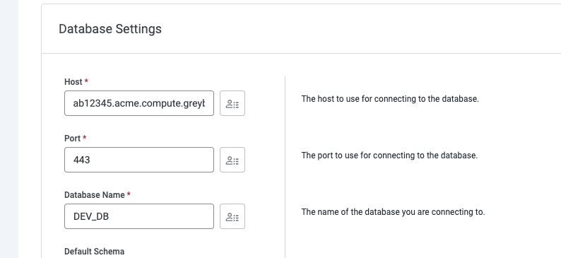
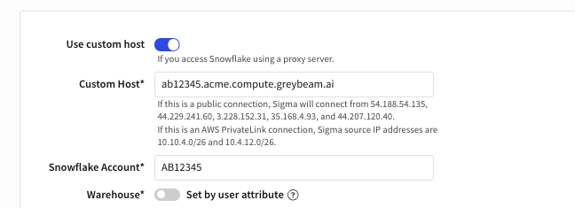
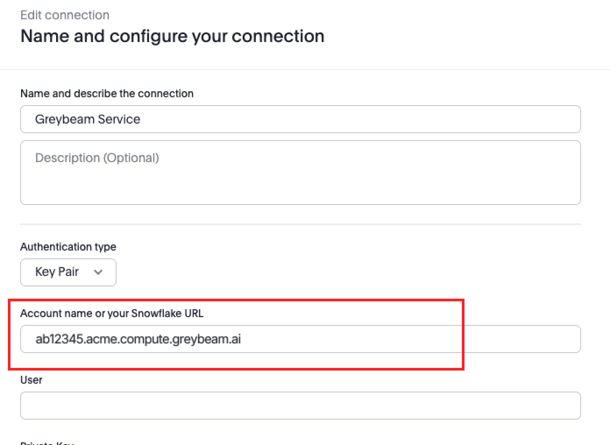
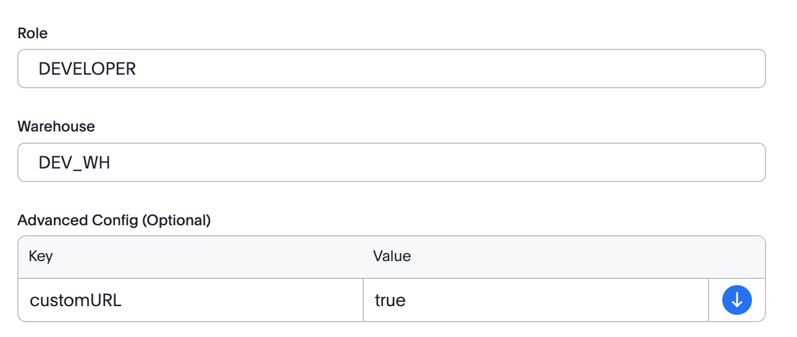
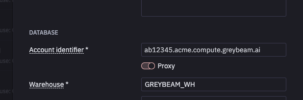
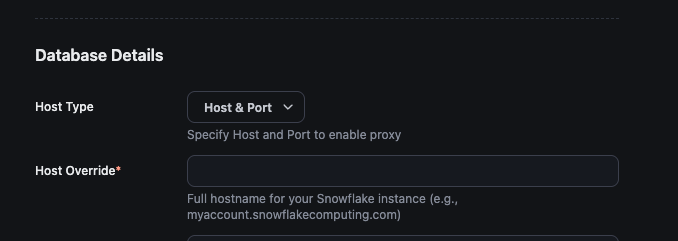
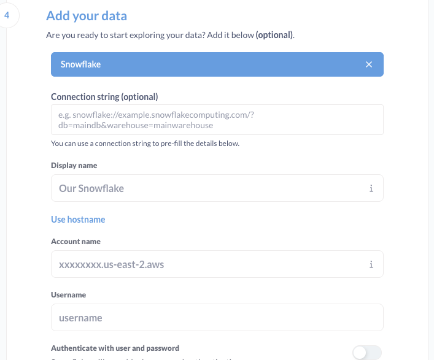

To connect a BI tool to Greybeam, point its existing Snowflake connection at your compute endpoint. Your users, roles, warehouses, and authentication stay the same.

Find your compute endpoint in the Greybeam platform under **Settings**. See [Find your compute endpoint](/get-started/compute-endpoint). The examples below use `ab12345.acme.compute.greybeam.ai`.

## Connect your tool

<Tabs>
  <Tab title="Looker">
    <Steps>
      <Step title="Open your connection">
        Go to **Admin** > **Database** > **Connections**, find your connection, and click **Edit**.
      </Step>
      <Step title="Set the host">
        Go to the next page of the connection settings. Set **Host** to `ab12345.acme.compute.greybeam.ai`. **Port** stays `443`.
      </Step>
    </Steps>

    <Frame>
      
    </Frame>
  </Tab>
  <Tab title="Sigma">
    <Steps>
      <Step title="Open your connection">
        Go to **Connections**, select your connection, then click **Manage** (top right).
      </Step>
      <Step title="Turn on the custom host">
        Click **Edit** (top right) and turn on **Use custom host**.
      </Step>
      <Step title="Set the host">
        In **Custom Host**, enter `ab12345.acme.compute.greybeam.ai`. **Snowflake Account** stays your Snowflake account identifier.
      </Step>
    </Steps>

    <Frame>
      
    </Frame>
  </Tab>
  <Tab title="ThoughtSpot">
    <Steps>
      <Step title="Open your connection">
        Open the **Data Workspace** tab, go to **Connections**, select your connection, then click **Edit** (top right).
      </Step>
      <Step title="Set the host">
        Set **Account name or your Snowflake URL** to `ab12345.acme.compute.greybeam.ai`.

        <Frame>
          
        </Frame>
      </Step>
      <Step title="Add the custom URL setting">
        At the bottom, expand **Advanced Config (Optional)**. Add the key `customURL` with the value `true`.

        <Frame>
          
        </Frame>
      </Step>
    </Steps>
  </Tab>
  <Tab title="Hex">
    <Steps>
      <Step title="Open your data source">
        Go to **Settings** > **Data sources** and click **Edit** on your Snowflake data source.
      </Step>
      <Step title="Turn on the proxy">
        Under **Account identifier**, turn on **Proxy** and enter `ab12345.acme.compute.greybeam.ai`.
      </Step>
    </Steps>

    <Frame>
      
    </Frame>
  </Tab>
  <Tab title="Omni">
    <Steps>
      <Step title="Open your connection">
        Go to **Settings** > **Connections** and select your connection.
      </Step>
      <Step title="Choose the host type">
        Under **Database Details**, set **Host Type** (the first setting) to **Host & Port**.
      </Step>
      <Step title="Set the host">
        In **Host Override**, enter `ab12345.acme.compute.greybeam.ai`.
      </Step>
    </Steps>

    <Frame>
      
    </Frame>
  </Tab>
  <Tab title="Metabase">
    <Steps>
      <Step title="Open your database">
        Go to **Admin settings** > **Databases**, select your Snowflake database, then click **Edit**.
      </Step>
      <Step title="Switch to a hostname">
        Click **Use hostname**. This swaps **Account name** for a host field.
      </Step>
      <Step title="Set the host">
        In **Host**, enter `ab12345.acme.compute.greybeam.ai`.
      </Step>
    </Steps>

    The same form appears when you add a new database, and in Metabase's first-run **Add your data** form.

    <Frame>
      
    </Frame>
  </Tab>
</Tabs>

## Confirm it worked

Run a query from a report or dashboard, then open **Home** in the Greybeam platform. The query appears with a routing code that shows whether it ran on DuckDB or fell back to Snowflake. See [Query history](/platform/query-history).

<Warning>
If the tool can't connect, check that your network allows it to reach the compute endpoint. A blocked network is the most common cause. For a vendor-hosted tool, the vendor's addresses must be allowed.
</Warning>

## Other tools

Other tools connect the same way if they use a [supported Snowflake driver](/connect/drivers). Tools that connect through ODBC aren't supported.

## Looker PDTs and Sigma datasets

Greybeam hydrates the Looker persistent derived tables (PDTs) and Sigma datasets you activate in **Objects Explorer**, like any other table. Until one has loaded, or while it's out of date, queries on it run on Snowflake. The routing code shows which kind was out of date:

| Code | Meaning |
|------|---------|
| `310` | DuckDB Looker PDT dataset is outdated |
| `304` | DuckDB Sigma dataset is outdated |
| `308` | DuckDB Sigma SIGDS dataset is outdated |
| `318` | Sigma transient dataset is outdated |

Looker builds PDTs with DDL, and Greybeam passes DDL straight to Snowflake. Use **Objects Explorer** to see the PDTs and datasets Greybeam tracks. See [Objects Explorer](/platform/objects-explorer).

## Related

<CardGroup cols={2}>
  <Card title="Routing codes" icon="list" href="/reference/routing-codes">
    What each code means.
  </Card>
  <Card title="Limitations" icon="triangle-exclamation" href="/reference/limitations">
    What runs on Snowflake instead of DuckDB.
  </Card>
  <Card title="Hydration" icon="rotate" href="/how-it-works/hydration">
    How Greybeam replicates and caches your tables.
  </Card>
  <Card title="Drivers" icon="plug" href="/connect/drivers">
    Supported Snowflake drivers and CLIs.
  </Card>
</CardGroup>
