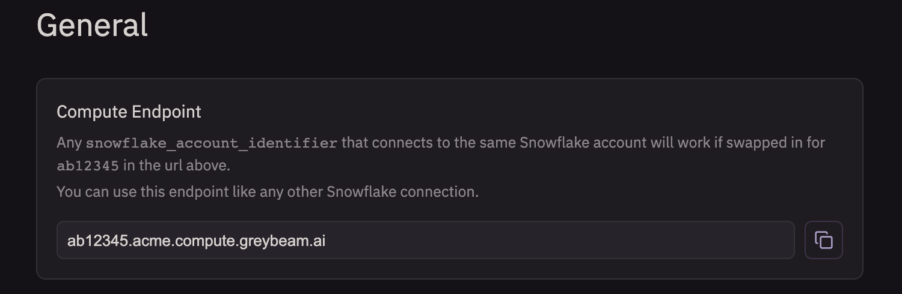
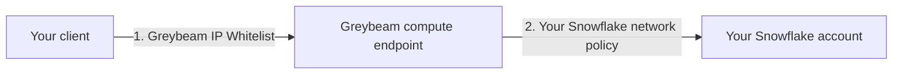

Your compute endpoint is the hostname your Snowflake clients connect to instead of Snowflake. It works with clients built on a [supported Snowflake driver](/connect/drivers). Copy it from the platform, swap it in for your Snowflake host, and check that your network allows the connection.

## Where to find it

<Steps>
  <Step title="Open Settings">
    In the Greybeam platform, click **Settings** in the sidebar.
  </Step>
  <Step title="Open General">
    Under **Greybeam**, click **General**. You can also type "Compute Endpoint" in the settings search.
  </Step>
  <Step title="Copy the hostname">
    In the **Compute Endpoint** card, click the copy button next to the hostname.

    <Frame>
       General with the Compute Endpoint card and its copy button highlighted" />
    </Frame>
  </Step>
</Steps>

If you don't see **Settings** in the sidebar, ask a Customer Admin in your organization to copy the endpoint for you.

## Hostname format

Your compute endpoint usually looks like this:

```text
<account_locator>.<customer_name>.compute.greybeam.ai
```

- `<account_locator>` is your Snowflake account identifier. Any account identifier that points to the same Snowflake account works in this position.
- `<customer_name>` is your organization's name in Greybeam.

Copy the exact value from the platform rather than building it by hand.

## What to change in your client

Change only the host, and set it to your compute endpoint. A supported client treats the compute endpoint like any other Snowflake connection.

Keep everything else as it is today:

- **Account:** your Snowflake account identifier.
- **User and authentication:** the same user, password, key pair, or SSO you use today.
- **Role, warehouse, database, and schema.**

Greybeam forwards your login to your Snowflake account. Queries that fall back to Snowflake run as your user, with your role and warehouse.

For client-specific instructions, see [Drivers](/connect/drivers), [BI tools](/connect/bi-tools), and [dbt](/connect/dbt).

## Allow Greybeam through your network

<Warning>
If a client can't connect through the compute endpoint, network allowlisting is the usual cause. Check both allowlists below.
</Warning>

When allowlisting is wrong, the client fails to connect or sign in through the compute endpoint, even though the same client connects to Snowflake directly. Your queries don't appear on **Home** in the Greybeam platform.

Two allowlists sit on the path between your client and Snowflake:



### 1. Allow your clients to reach Greybeam

Greybeam can restrict which IP addresses may connect to your compute endpoint. When this is on for your account, a Customer Admin manages the list in **Settings** > **General** > **IP Whitelist**:

<Steps>
  <Step title="Add an address">
    Click **Add IP**.
  </Step>
  <Step title="Enter the client's IP">
    Enter the client's outbound IP address, or a CIDR range such as `10.0.0.0/24`. Add a **Comment** so you remember what it is.
  </Step>
  <Step title="Save">
    Click **Save Whitelist**.
  </Step>
</Steps>

Add every place that connects to the compute endpoint: your BI tool's outbound IPs, dbt and orchestration runners, app servers, and the office or VPN addresses your analysts use.

If you don't see **IP Whitelist** on the page, ask Greybeam in your shared Slack channel whether your account restricts client IPs.

### 2. Allow Greybeam to reach Snowflake

Greybeam signs in to Snowflake on your users' behalf, from Greybeam's IP addresses. If a Snowflake network policy applies to the user your client signs in as, that policy must allow Greybeam's IP addresses.

- **Account-level policy.** Add Greybeam's addresses to the policy's allowed list.
- **User-level policy.** In Snowflake, a policy set on a user overrides the account-level policy. If your BI service user has its own policy, add Greybeam's addresses there too.

Use the IP addresses shown in the **Network Access** step of [onboarding](/get-started/onboarding#step-2-network-access). The policy that step creates covers only `GREYBEAM_USER`, not your other users. Creating or changing network policies needs `SECURITYADMIN` or a role with equivalent privileges.

### If you still can't connect

If you've checked both allowlists and still can't connect, ask in your shared Slack channel with Greybeam. Include the client, the time you tried, and the error message.

## Related

<CardGroup cols={2}>
  <Card title="Next: Quickstart" icon="rocket" href="/quickstart">
    Connect a client and confirm a query ran on DuckDB.
  </Card>
  <Card title="Settings" icon="gear" href="/platform/settings">
    Everything else on the Settings page.
  </Card>
</CardGroup>
