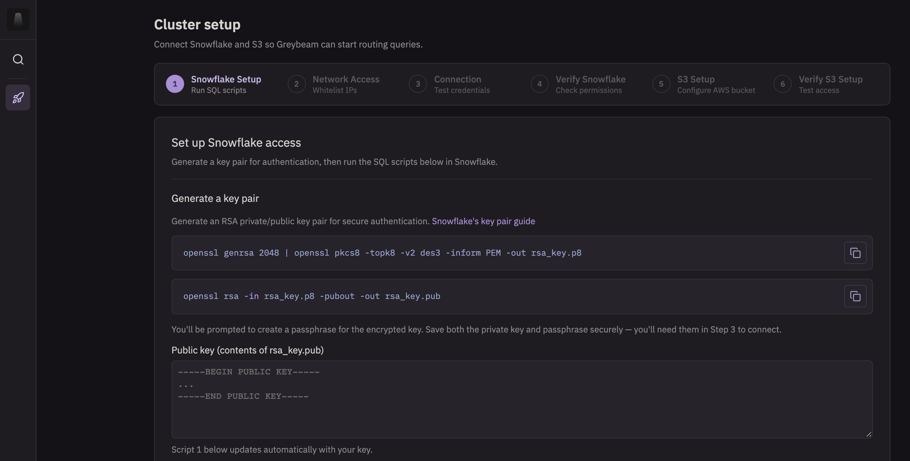

The onboarding wizard connects Greybeam to your Snowflake account and to an S3 bucket in your AWS account. Each section below matches one of the wizard's six steps.

## Before you start

- **A Greybeam platform login.** Greybeam emails you an invitation. Accept it and sign in at `https://demo.admin.greybeam.ai`.
- **The Customer Admin role in the platform.** Only users who can manage connection settings can open the wizard.
- **Snowflake access to `ACCOUNTADMIN`.** The setup scripts switch between `USERADMIN`, `SECURITYADMIN`, `SYSADMIN`, and `ACCOUNTADMIN`.
- **An AWS account where you can create an S3 bucket and IAM role,** and Terraform to apply the generated configuration.
- **OpenSSL,** to generate a key pair.

## How the wizard works

While your account is in onboarding, the platform shows only **Onboarding**. The wizard saves your progress after each step, so you can leave and come back. Use **Back** or the step list at the top to revisit a completed step.

<Frame>
  
</Frame>

<Note>
The wizard fills your account's values into every script and configuration it shows. Copy them from the wizard, not from this page.
</Note>

## Step 1: Snowflake Setup

You create a Snowflake user, role, warehouses, and storage objects for Greybeam.

### Generate a key pair

Greybeam signs in to Snowflake with key-pair authentication. Run the two commands the wizard shows:

```bash
openssl genrsa 2048 | openssl pkcs8 -topk8 -v2 des3 -inform PEM -out rsa_key.p8
openssl rsa -in rsa_key.p8 -pubout -out rsa_key.pub
```

OpenSSL prompts you for a passphrase. Store the private key (`rsa_key.p8`) and the passphrase securely. You need both in step 3.

Paste the contents of `rsa_key.pub` into **Public key**. Script 1 updates with your key.

### Run the SQL scripts

Expand each script, copy it, and run it in Snowflake in order. **Copy all scripts** copies all six at once. The wizard asks for three inputs between the scripts, shown here where they come up.

<Steps>
  <Step title="Run script 1: Create User, Role & Warehouse">
    Creates the `GREYBEAM_USER` service user and `GREYBEAM_ROLE`, and sets your public key on the user. It also creates two extra-small warehouses that auto-suspend after 60 seconds: `GREYBEAM_WH`, and a second warehouse Greybeam uses to test query performance in isolation.

    Uses `USERADMIN`, `SECURITYADMIN`, `ACCOUNTADMIN`, and `SYSADMIN`.
  </Step>
  <Step title="Choose your S3 bucket">
    The wizard shows a default bucket name. To use your own, turn on **Use custom bucket name**, enter a name, and click **Save**. Names must be 3–63 characters of lowercase letters, numbers, periods, or hyphens.
  </Step>
  <Step title="Run script 2: Storage Integration">
    Creates `GREYBEAM_HYDRATION_S3_INTEGRATION`, which gives Snowflake secure access to your S3 bucket. Its last query returns two values you need next.

    Uses `ACCOUNTADMIN`.
  </Step>
  <Step title="Save the storage integration values">
    Copy `STORAGE_AWS_IAM_USER_ARN` and `STORAGE_AWS_EXTERNAL_ID` from script 2's result into the matching fields, then click **Save**. Script 3 updates with these values.

    **Continue** stays disabled until you save these values.
  </Step>
  <Step title="Run script 3: External Volume">
    Creates `GREYBEAM_HYDRATION_S3_EXTERNAL_VOLUME`, the location in your S3 bucket where Greybeam replicates your tables as Iceberg tables.

    Uses `ACCOUNTADMIN`.
  </Step>
  <Step title="Run script 4: Create Database & CDC Schemas">
    Creates `GREYBEAM_DB` with the `CDC_STREAMS` and `STAGES` schemas, owned by `GREYBEAM_ROLE`. Greybeam stages change-data-capture and hydration data here.

    Uses `SYSADMIN` and `SECURITYADMIN`.
  </Step>
  <Step title="List the warehouses to monitor">
    List the warehouses Greybeam should monitor, separated by commas or new lines. Script 5 grants `MONITOR` on each.

    Or turn on **Allow managing all warehouses** to grant `MANAGE WAREHOUSES` on the account instead. That grant includes monitor, operate, create, and modify permissions.
  </Step>
  <Step title="Run script 5: Metadata Access">
    Lets Greybeam read query and warehouse usage, so it can find eligible queries and monitor costs.

    Uses `ACCOUNTADMIN`.
  </Step>
  <Step title="Run script 6: Production Table Access">
    Gives `GREYBEAM_ROLE` read access to the data you want to run on DuckDB. Uses `SECURITYADMIN`.

    Run one of the two options, after replacing its placeholder values with your own:

    - **Option A (recommended if you have one):** grant your BI tool's Snowflake role to `GREYBEAM_ROLE`. Greybeam can then read everything your BI tool reads. Replace `Insert BI tool role here`.
    - **Option B:** grant read access to a database directly. It grants `USAGE` on the database and its schemas, and `SELECT` on all current and future tables, dynamic tables, and views. Replace `Insert database name here` and `Insert schema name here`.

    Greybeam can only run queries on DuckDB for tables `GREYBEAM_ROLE` can read. You can grant more access later.
  </Step>
</Steps>

## Step 2: Network Access

You allow Greybeam's IP addresses through your Snowflake network policy.

The wizard lists Greybeam's IP addresses. Copy them from the wizard and add them to any IP allowlist that applies to your Snowflake account.

Then run the SQL script the wizard shows. It creates a network policy with those addresses and attaches it to `GREYBEAM_USER`:

```sql
SET user_name = 'GREYBEAM_USER';

USE ROLE SECURITYADMIN;
CREATE NETWORK POLICY IF NOT EXISTS greybeam_network_policy
  ALLOWED_IP_LIST = ('<greybeam_ip_1>', '<greybeam_ip_2>', '<greybeam_ip_3>')
  COMMENT = 'Network policy for Greybeam';

ALTER USER identifier($user_name) SET NETWORK_POLICY = greybeam_network_policy;
```

<Warning>
This policy covers only Greybeam's own user. Your clients' Snowflake users may need Greybeam's addresses too. See [Find your compute endpoint](/get-started/compute-endpoint#allow-greybeam-through-your-network).
</Warning>

## Step 3: Connection

You give Greybeam the credentials for `GREYBEAM_USER`. Greybeam uses this connection to read metadata, monitor queries, and hydrate data for DuckDB.

<Steps>
  <Step title="Enter your Snowflake account">
    Enter your **Snowflake account** identifier, for example `myorg-myaccount`.
  </Step>
  <Step title="Check the defaults">
    Keep the defaults for **Username** (`GREYBEAM_USER`), **Role** (`GREYBEAM_ROLE`), **Warehouse** (`GREYBEAM_WH`), and **Database** (`GREYBEAM_DB`) unless you changed them in the scripts.
  </Step>
  <Step title="Add your private key">
    Paste the contents of `rsa_key.p8` into **Private key (PEM format)**, and enter your **Private key passphrase**.
  </Step>
  <Step title="Test the connection">
    Click **Test connection**. Greybeam saves your credentials and opens a Snowflake session with them.

    When the test passes, you see **Connection successful.** and an **Accessible databases** list. These are the databases Greybeam can already read. If the list is empty, grant `GREYBEAM_ROLE` access to your data with script 6.
  </Step>
</Steps>

If the test fails, see [Connection test](/troubleshooting/onboarding-verification#connection-test).

## Step 4: Verify Snowflake

You confirm the Snowflake setup is complete. Click **Run verification**. The checks run one at a time:

- **Database & CDC schemas.** `GREYBEAM_ROLE` can use `GREYBEAM_DB`, owns the `CDC_STREAMS` and `STAGES` schemas, and can create objects in them. Fix with `SYSADMIN` or `SECURITYADMIN`. [Troubleshoot](/troubleshooting/onboarding-verification#database-and-cdc-schemas).
- **Metadata access.** `GREYBEAM_ROLE` can query Snowflake usage metadata and monitor warehouses. Usually fixed with `ACCOUNTADMIN`. [Troubleshoot](/troubleshooting/onboarding-verification#metadata-access).
- **Available objects.** Greybeam can see at least one table or view. The wizard lists every object it found. Fix with `SECURITYADMIN`, or the role that manages your grants. [Troubleshoot](/troubleshooting/onboarding-verification#available-objects).

If the first two checks fail, the wizard shows the SQL that fixes them (script 4 or 5). Run it, check your step 3 credentials, and click **Retry verification**. If **Available objects** fails, grant `GREYBEAM_ROLE` read access with script 6.

All checks must pass before you can continue.

## Step 5: S3 Setup

You create the S3 bucket and IAM role Greybeam and Snowflake use for hydration data.

The wizard generates Terraform for your AWS account from your bucket name and storage integration values. Copy it and apply it in your AWS account. It creates:

- The S3 bucket, with public access blocked and server-side encryption on.
- A cross-account IAM role that Greybeam and Snowflake can assume, with a policy that grants access to the bucket.

You need AWS permissions to create S3 buckets, IAM roles, and IAM policies. Apply the Terraform before you continue.

## Step 6: Verify S3 Setup

You confirm Snowflake and Greybeam can both use the bucket. Click **Run verification**:

- **Storage integration.** Snowflake can write, list, and remove files in your bucket through the storage integration. Usually fixed with `ACCOUNTADMIN`. [Troubleshoot](/troubleshooting/onboarding-verification#storage-integration).
- **External volume.** Snowflake can create an Iceberg table on the external volume, and read, write, update, and delete rows in it. Usually fixed with `ACCOUNTADMIN`. [Troubleshoot](/troubleshooting/onboarding-verification#external-volume).
- **S3 bucket access.** Greybeam can write, list, read, and delete a test file in your bucket directly. Fixed with AWS permissions. [Troubleshoot](/troubleshooting/onboarding-verification#s3-bucket-access).

Each check attempts to clean up its test files and tables. When all three pass, click **Complete setup**.

## After setup

The wizard shows **Setup complete**. Greybeam's team then finishes configuring your account and reaches out when it's ready. If you have questions in the meantime, ask in your shared Slack channel with Greybeam.

## Related

<CardGroup cols={2}>
  <Card title="Next: Find your compute endpoint" icon="server" href="/get-started/compute-endpoint">
    Get the hostname your clients connect to.
  </Card>
  <Card title="Onboarding verification errors" icon="clipboard-check" href="/troubleshooting/onboarding-verification">
    Fix a verification check that fails.
  </Card>
</CardGroup>
