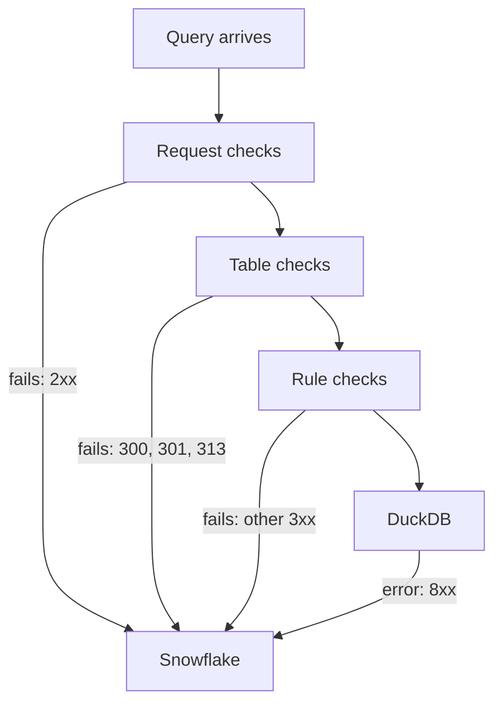

Greybeam decides, query by query, whether to run on DuckDB or on your Snowflake account. Read on to see how that decision works and how to find out why a query ran where it did.

## The short version

Every query you send to your compute endpoint goes through Greybeam's decision engine. If the query is eligible, it runs on DuckDB. If it isn't, it runs on Snowflake. If DuckDB tries the query and fails, Greybeam runs it on Snowflake instead. This is called falling back to Snowflake.

Each query gets a [routing code](/reference/routing-codes) that records the outcome and the reason.

The kill switch overrides everything: if routing is switched off, every query goes to Snowflake with a 9xx code. A query that passes every check and succeeds on DuckDB gets code `100`.

## What your client sees

Your client always gets a normal Snowflake response. It doesn't matter whether the query ran on DuckDB, ran on Snowflake, or fell back. Your BI tool, driver, or dbt project doesn't need to know which engine answered.

If a query fails on Snowflake too, your client gets Snowflake's error, as it would without Greybeam.

Turning off the **Platform** switch doesn't interrupt your clients either. Queries keep running, all on Snowflake. See [The platform switch](/platform/overview#the-platform-switch).

## The checks in order

Greybeam runs these checks in order and stops at the first one that fails. The routing code you see belongs to that check. A query can fail later checks too, so fixing one reason can reveal the next.

A query that passes every check runs on DuckDB ([100](/reference/routing-codes#1xx-ran-on-duckdb)).

### Request checks

1. **Kill switch.** If the **Platform** switch is off, or Greybeam has turned routing off for your account, the query goes to Snowflake ([900, 901](/reference/routing-codes#9xx-kill-switch)). This overrides everything below, including a forced engine.
2. **SQL size.** SQL text over 100 KB goes to Snowflake ([207](/reference/routing-codes#2xx-requests-that-run-only-on-snowflake)).
3. **Forced engine.** If a specific engine was requested, for example from the [Query Runner](/platform/query-runner), Greybeam uses it and skips the rest ([700](/reference/routing-codes#700-forced-routing)). Two cases are rejected instead: a Query Runner request to run a write statement (DML, DDL, or DCL) on either engine, and a request to force DuckDB for a query whose tables are too large for DuckDB.
4. **Parsing.** SQL Greybeam can't parse goes to Snowflake ([206](/reference/routing-codes#2xx-requests-that-run-only-on-snowflake)).
5. **dbt.** Queries from a dbt run go to Snowflake ([214](/reference/routing-codes#2xx-requests-that-run-only-on-snowflake)). See [dbt](/connect/dbt).
6. **Statement type.** Only read queries continue. Metadata, transaction, DDL, DML, DCL, `EXPLAIN`, and unknown statements go to Snowflake ([2xx](/reference/routing-codes#2xx-requests-that-run-only-on-snowflake)). So do table existence checks from BI tools ([311](/reference/routing-codes#3xx-supported-but-held-back)).
7. **Client request.** Requests for a result format Greybeam can't return from DuckDB ([210](/reference/routing-codes#2xx-requests-that-run-only-on-snowflake)), or describe-only requests from drivers ([211](/reference/routing-codes#2xx-requests-that-run-only-on-snowflake)), go to Snowflake.

### Table checks

These apply to every table in the query. One inactive or stale table sends the whole query to Snowflake.

8. **Tables tracked.** Every table must be visible to Greybeam's Snowflake role ([300](/reference/routing-codes#300-tables-in-query-not-tracked)).
9. **BI datasets current.** A Looker PDT or Sigma dataset rebuilt since Greybeam's last load goes to Snowflake ([304, 310, 318](/reference/routing-codes#3xx-supported-but-held-back)).
10. **Tables active.** Every table must be turned on in [Objects Explorer](/platform/objects-explorer) ([301](/reference/routing-codes#301-tables-in-query-not-active)).
11. **Tables loaded and fresh.** Every table must be loaded on DuckDB and within your freshness threshold ([313](/reference/routing-codes#313-tables-data-is-stale-or-not-route-ready)). See [Hydration](/how-it-works/hydration#freshness-and-staleness).

### Rule checks

12. **Supported functions.** Queries using `CONVERT_TIMEZONE` or `GENERATOR` with `TIMELIMIT` go to Snowflake ([312, 314](/reference/routing-codes#3xx-supported-but-held-back)).
13. **Blacklist.** Queries matching a [Query Blacklist](/platform/query-blacklist) entry go to Snowflake ([305–307](/reference/routing-codes#305-query-is-blacklisted-sql-text)).
14. **Size.** Queries whose tables add up to more than a DuckDB worker takes go to Snowflake ([302](/reference/routing-codes#302-tables-in-query-too-large)).
15. **SQL filter.** If **SQL Filter Regex** is on in [Settings](/platform/settings), queries that don't match it go to Snowflake ([303](/reference/routing-codes#3xx-supported-but-held-back)).

## When DuckDB fails

A query that reaches DuckDB can still fail. DuckDB might not support something in the query, a table might be behind, the query might run too long, or DuckDB might be at capacity. When that happens, Greybeam runs the query on your Snowflake account and records an [8xx code](/reference/routing-codes#8xx-duckdb-failed-then-fell-back-to-snowflake).

Two things follow:

- **Your client gets Snowflake's response.** The query runs on Snowflake, so your client gets Snowflake's result, or Snowflake's error if Snowflake also fails.
- **The query took longer.** Snowflake started only after DuckDB failed.

Queries that keep timing out on DuckDB are added to the [Query Blacklist](/platform/query-blacklist) automatically, so later runs skip DuckDB.

## Snowflake bounces

A **Snowflake bounce** is a query that could plausibly have run on DuckDB but ran on Snowflake. That includes queries held back by a table's state or a rule (most 3xx codes), queries that fell back after DuckDB failed (8xx), and queries sent to Snowflake because routing was switched off (9xx). Queries DuckDB is never meant to run, such as writes and metadata commands, aren't bounces.

Bounces are the queries to look at if you want more of your workload on DuckDB. The **Queries Routed to Snowflake** chart on **Analytics** > **Queries** breaks them down by reason. Greybeam's team also watches routing on your account and works to move more queries to DuckDB.

## See the decision for a query

<Steps>
  <Step title="Find the query">
    Open **Home** in the [Greybeam platform](https://demo.admin.greybeam.ai). The **CODE** column shows each query's routing code. Hover over a code to see its label. To find every query with a given code, use the **Routing Code** filter. See [Query history](/platform/query-history).
  </Step>
  <Step title="Open the details">
    Double-click the row. The [query details](/platform/query-details) show the **Engine**, the **Code**, and the **Routing Reason**. For many codes, **Details** adds specifics, such as which tables were inactive or the error DuckDB returned.
  </Step>
  <Step title="Look up the code">
    Find the code in [Routing codes](/reference/routing-codes) for its common causes and what you can do.
  </Step>
</Steps>

To see trends rather than single queries, use [Analytics](/platform/analytics). It shows how many queries ran on each engine and why queries went to Snowflake.

If you can't tell why a query ran where it did, copy its **Query ID** from the query details and share it with Greybeam in your Slack channel.

## Related

<CardGroup cols={2}>
  <Card title="Routing codes" icon="signs-post" href="/reference/routing-codes">
    Look up what a routing code means and what you can do.
  </Card>
  <Card title="Hydration" icon="droplet" href="/how-it-works/hydration">
    Learn how Greybeam replicates and caches your tables and keeps them fresh.
  </Card>
  <Card title="Query details" icon="magnifying-glass" href="/platform/query-details">
    See the engine, code, and routing reason for one query.
  </Card>
  <Card title="Query blacklist" icon="ban" href="/platform/query-blacklist">
    Review the queries Greybeam always sends to Snowflake.
  </Card>
</CardGroup>
