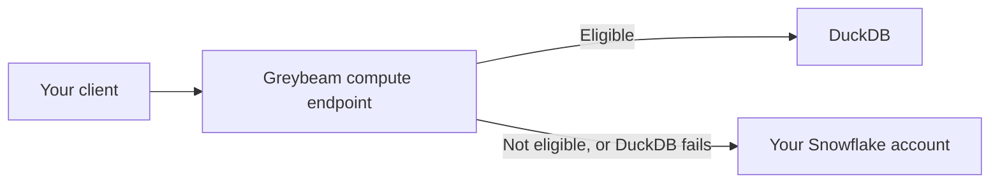

Greybeam runs your eligible Snowflake queries on DuckDB, with no SQL to rewrite. You point your existing Snowflake clients at Greybeam, and it sends each query to DuckDB when it can and to your Snowflake account when it can't. Your clients always get a normal Snowflake response.

<Frame>
  <video
    autoPlay
    muted
    loop
    playsInline
    className="w-full aspect-video"
    poster="/images/how-greybeam-works-poster.png"
    src="/videos/how-greybeam-works.mp4"
    aria-label="Animation: clients connect to a Greybeam compute endpoint, which routes each query to DuckDB or Snowflake"
  ></video>
</Frame>

## How it works

Your BI tools, dbt, drivers, and apps connect to your Greybeam **compute endpoint** instead of Snowflake. The compute endpoint is a Snowflake-compatible API, so clients built on a supported Snowflake driver (Python, JDBC, Go, or Node.js) can connect to it. See [Drivers](/connect/drivers).

For every query, Greybeam:

1. Checks whether the query can run on DuckDB. For example, the tables it reads must be active in Greybeam, and the SQL must be a supported query type.
2. Runs eligible queries on DuckDB, which Greybeam provisions and manages. Greybeam translates your Snowflake SQL to DuckDB SQL for you.
3. Sends everything else to your Snowflake account. If a DuckDB query fails, Greybeam falls back to Snowflake too. The platform calls these **Snowflake bounces**.
4. Records a **routing code** that tells you where the query ran and why. Code `100` means it ran on DuckDB with no issues. See [Routing codes](/reference/routing-codes).

To run queries on DuckDB, Greybeam replicates your tables from Snowflake into your S3 bucket, and its DuckDB workers cache them for performance. Greybeam keeps both in sync with Snowflake. This is called **hydration**. You choose which tables Greybeam hydrates by marking them active in **Objects Explorer**. See [Hydration](/how-it-works/hydration).

## What changes for you

Only the host your clients connect to. You replace your Snowflake hostname with your compute endpoint.

Everything else stays the same:

- **Your SQL.** Clients keep sending Snowflake SQL.
- **Your Snowflake setup.** Your account identifier, users, roles, warehouses, databases, and authentication don't change.
- **Your tools.** BI semantic layers, dashboards, and scheduled jobs keep working as they are.
- **Your fallback.** Any query Greybeam can't run on DuckDB still runs on Snowflake.

## The Greybeam platform

You use the Greybeam platform at `https://demo.admin.greybeam.ai` to see where each query ran, choose which tables to hydrate, and debug routing. Greybeam's team also monitors your account and works to route more of your queries to DuckDB over time.

## Get started

Follow these pages in order to go from a new account to your first query on DuckDB.

<Steps>
  <Step title="Set up your account">
    Complete the onboarding wizard to connect Greybeam to your Snowflake account and S3 bucket. See [Set up your account](/get-started/onboarding).
  </Step>
  <Step title="Find your compute endpoint">
    Copy the hostname your clients connect to, and make sure your network allows it. See [Find your compute endpoint](/get-started/compute-endpoint).
  </Step>
  <Step title="Connect your first client">
    Change one client's host, run a query, and confirm it ran on DuckDB. See [Quickstart](/quickstart).
  </Step>
</Steps>

## Related

<CardGroup cols={2}>
  <Card title="Query routing" icon="route" href="/how-it-works/query-routing">
    Learn how Greybeam decides where each query runs.
  </Card>
  <Card title="Hydration" icon="droplet" href="/how-it-works/hydration">
    Learn how Greybeam replicates and caches your tables.
  </Card>
  <Card title="Platform overview" icon="compass" href="/platform/overview">
    Tour the Greybeam platform.
  </Card>
  <Card title="Routing codes" icon="signs-post" href="/reference/routing-codes">
    Look up what a routing code means.
  </Card>
</CardGroup>
