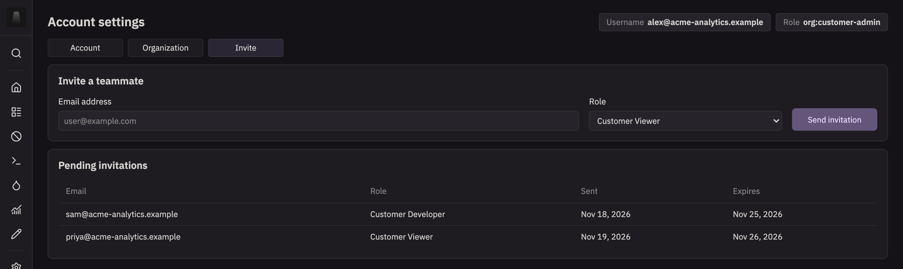

**Account settings** is where you manage your own profile and, if you're an admin, your organization's members and invitations. Open it from the sidebar footer.

<Frame>
  
</Frame>

The header shows your **Username** and **Role**. Which tabs you see depends on your role.

- **Account** (everyone) — Your profile and sign-in details.
- **Organization** (Customer Admins) — Your organization's profile and its members.
- **Invite** (Customer Admins) — Invite teammates and see pending invitations.

## Roles

Each member has one role. Roles control what a person can see and change in the platform. Each role can do everything the one before it can.

### Customer Viewer

- View [Query history](/platform/query-history), [Analytics](/platform/analytics), and [Hydration jobs](/platform/hydration-jobs).
- View [Objects Explorer](/platform/objects-explorer), [Query blacklist](/platform/query-blacklist), and [dbt Projects](/platform/dbt-projects).

### Customer Developer

- Add or deactivate [blacklist](/platform/query-blacklist) entries.
- Use the [Query runner](/platform/query-runner).
- Use the global platform switch.
- View [Settings](/platform/settings) as read-only, plus some **Actions**.

### Customer Admin

- Turn tables and dbt targets on or off, and edit table and hydration settings.
- Edit Settings, including the Snowflake connection.
- Manage members and send invitations.

<Note>
Your Customer Admins decide who gets which role. If a control is greyed out or a page is missing, ask a Customer Admin to change your role.
</Note>

## Your account

The **Account** tab holds your own profile and sign-in details. Everyone can open it, whatever their role.

## Organization and members

The **Organization** tab shows your organization's profile and its member list. Customer Admins use it to review who has access and to manage members.

## Invite a teammate

Customer Admins can invite people from the **Invite** tab.

<Steps>
  <Step title="Open the Invite tab">
    Click **Invite** in the tab bar.
  </Step>
  <Step title="Fill in the form">
    Under **Invite a teammate**, enter their **Email address** and choose a **Role**: **Customer Viewer** (the default), **Customer Developer**, or **Customer Admin**.
  </Step>
  <Step title="Send">
    Click **Send invitation**. The person gets an email with a link to join.
  </Step>
</Steps>

New people join by accepting the emailed invitation and signing in with their email address. Pending invitations appear in a table below the form with **Email**, **Role**, **Sent**, and **Expires**.

<Tip>
Start people at **Customer Viewer** and raise the role when they need more.
</Tip>

## Related

<CardGroup cols={2}>
  <Card title="Settings" icon="gear" href="/platform/settings">
    What Developers can view and Admins can edit.
  </Card>
  <Card title="Platform overview" icon="compass" href="/platform/overview">
    A tour of the platform and its sidebar.
  </Card>
</CardGroup>
