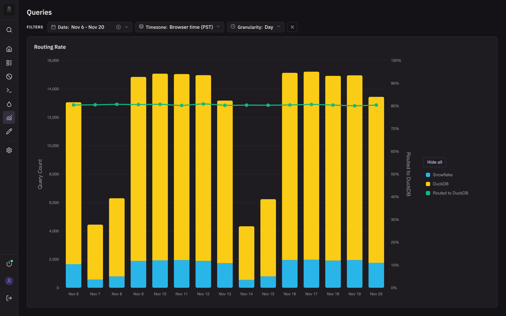
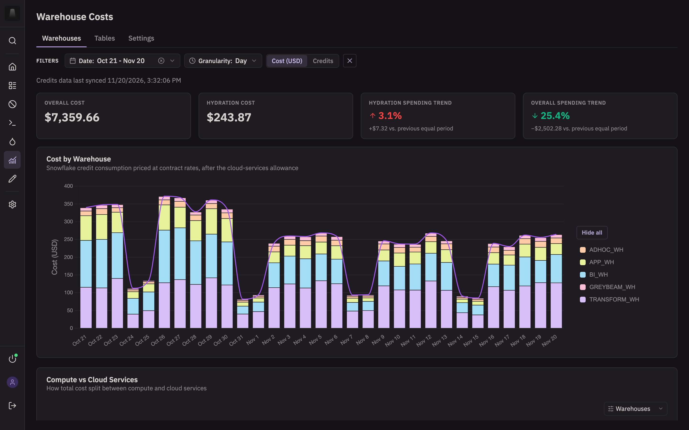

**Analytics** shows trends across all your queries and Snowflake spend. Use it to see how much traffic runs on DuckDB, why the rest goes to Snowflake, and what your warehouses cost.

Hover over **Analytics** in the sidebar to choose a page: **Queries** or **Warehouse Costs**. Clicking **Analytics** itself opens **Queries**.

## Queries

**Queries** charts routing, cache, blacklist, and latency over time.

<Frame>
   Queries with the filter bar and the Routing Rate and Queries Routed to Snowflake charts" />
</Frame>

### Filters

The filter bar at the top applies to every chart on the page.

- Date range — defaults to the last 14 days. Choose **Relative** for **Last 2 days**, **Last week**, **Last 2 weeks**, **Last month**, or a **Custom** "Last _n_ days, weeks, or months", then click **Apply**. Or choose **Date range** to pick start and end dates.
- **Timezone** — time zone for the chart buckets: **Browser time** (the default), **Eastern Time**, **Central Time**, **Mountain Time**, **Pacific Time**, or **UTC**.
- **Granularity** — bucket size: **Hour**, **Day** (the default), **Week**, or **Month**.
- **X** (Clear filters) — clears the date range and sets granularity back to **Day**.

### Reading the charts

- Hover over a bar or point to see exact values.
- Click an item in a chart's legend to hide or show that series. Where there's a **Hide all** button, use it to clear the chart, then click just the series you want. **Select all** brings them back.

### Routing Rate

Stacked bars show how many queries ran on **DuckDB** and on **Snowflake** in each bucket. The line, **Routed to DuckDB**, is the percentage of all queries that DuckDB answered successfully, including results-cache hits. Read it on the right-hand axis.

Use it to answer "is my routing rate going up or down?" A drop usually means new traffic is hitting tables that aren't on DuckDB yet, such as a newly built dbt model that hasn't been turned on.

### Queries Routed to Snowflake

This is the Snowflake bounces chart, subtitled "Why queries couldn't run on DuckDB". Each bar is split by routing code, labeled like `301: Table(s) in query not active`.

A **Snowflake bounce** is a query that could plausibly have run on DuckDB but ran on Snowflake. That includes:

- Queries that something kept off DuckDB (3xx codes), such as an inactive, untracked, too large, or out-of-date table, or a blacklist entry (`305` to `307`).
- Queries Greybeam couldn't parse or doesn't support yet, such as SQL over 100KB (some 2xx codes).
- Queries that failed on DuckDB and fell back (8xx codes).
- Queries sent while the **Platform** switch was off (`900`).

Queries that belong on Snowflake by design aren't bounces and don't appear here. Examples are DDL, DML, metadata, and transaction queries.

Use it to find the biggest reason for bounces, then fix that first. For what each code means, see [Routing codes](/reference/routing-codes). To see the individual queries, filter **Home** by the same code. See [Query history](/platform/query-history#find-out-why-a-query-ran-on-snowflake).

<Note>
Some bounces are intentional. For example, a very large table may be left inactive on purpose, and switching the platform off sends everything to Snowflake. A bounce isn't an error by itself: Greybeam runs the query on Snowflake and returns Snowflake's result or error.
</Note>

### Inactive Tables

"Queries on tables not active in Greybeam." This breaks down inactive-table bounces (code `301`) by table. It shows the top 5 inactive tables per hour and groups the rest as **Other**.

Use it to decide which tables to turn on in [Objects Explorer](/platform/objects-explorer). The tables with the tallest bars would move the most queries to DuckDB.

### Results Cache Hit Rate

"Percentage of DuckDB queries served from results cache." Bars show **Hits** and **Misses**; the **Rate** line shows the hit percentage. A hit means DuckDB returned a stored result instead of running the query again.

### Blacklisted Queries

"Top 20 blacklist rules by query count." The chart shows how many queries each [blacklist](/platform/query-blacklist) rule sent to Snowflake over time.

Under the chart, a table lists each rule:

- **Type** — **SQL Text**, **Tables Included**, or **Tables Joined**.
- **Lookup Hash** — the hash the rule matches. Click the copy icon to copy it.
- **Total Count** — queries the rule matched in the selected range.
- **Created At** — when the rule was added.

Click a row to show only that rule in the chart; click **Clear** to show all again. Use **Search by hash or type...** to filter the table, and **Rows**, **Prev**, and **Next** to page through it.

Use it to spot a rule that's sending a lot of traffic to Snowflake. If a rule no longer makes sense, remove it in [Query Blacklist](/platform/query-blacklist).

### Query Latency by Engine

Lines compare query latency on DuckDB and Snowflake. The title ends with the selected metric, for example **Query Latency by Engine - Total Runtime**.

- **Metric** — **Total**, **Processing**, **Queued**, or **Running**. These are the same phases as the duration bars in [query history](/platform/query-history#duration-bars).
- Legend — medians show by default. Each engine also has **Min**, **P25**, **P75**, **P90**, **P99**, and **Max**; click any of them to add it.
- **Include cache hits in medians** (for **Total** and **Processing** only) — turn it off to see medians for queries that actually ran. Cache hits are fast, so they pull the median down.

For granularities other than **Hour**, medians are approximations.

## Warehouse Costs

**Warehouse Costs** shows Snowflake credit usage and spend for the warehouses you track, plus how much hydrating each table costs. It has three tabs: **Warehouses**, **Tables**, and **Settings**.

<Note>
Only tracked warehouses appear. To track more, see [Choose which warehouses to track](#choose-which-warehouses-to-track).
</Note>

### Warehouses tab

The **Warehouses** tab shows spend per warehouse. Use it to watch the cost of keeping DuckDB in sync. Faster refresh schedules and bigger hydration warehouses raise **Hydration cost**. See [Hydration](/how-it-works/hydration).

<Frame>
   Warehouses tab with the summary cards and the Cost by Warehouse chart" />
</Frame>

**Filters**

- Date range — defaults to the last 30 days. Same picker as on **Queries**.
- **Granularity** — **Hour**, **Day** (the default), **Week**, or **Month**.
- **Show amounts as** — **Cost** (in your Snowflake currency, the default) or **Credits**. **Cost** is unavailable when there's no Snowflake pricing for the selected range; the page then shows credits.
- **X** (Clear filters) — returns to the last 30 days and **Day**.

The line under the filters shows when credits data last synced.

**Summary cards**

- **Overall cost** (or **Overall credits**) — total for all tracked warehouses in the range.
- **Hydration cost** (or **Hydration credits**) — the share used by the warehouse Greybeam uses for hydration, which is set in [Settings](/platform/settings). Shows "No hydration warehouse configured" if none is set.
- **Hydration spending trend** — change in hydration spend compared with the previous period of the same length.
- **Overall spending trend** — change in total spend compared with the previous period of the same length.

**Charts**

- **Cost by Warehouse** (or **Credits by Warehouse**) — stacked bars per warehouse, plus a **7-day avg** line for the warehouses you're showing. In cost mode, it's credit use priced at your Snowflake contract rates, after the cloud-services allowance. Click warehouses in the legend to hide or show them.
- **Compute vs Cloud Services** — how the total splits between **Compute** and **Cloud services**. Use **Warehouses** above the chart to pick which warehouses to include.

### Tables tab

The **Tables** tab estimates what each active table costs to hydrate and how much DuckDB traffic it gets. Use it to find tables you pay to hydrate but rarely query on DuckDB.

It uses UTC dates and has only the date range filter. The line under the filters shows when table usage data starts.

**Summary cards**

- **Active tables** — tables turned on.
- **Zero DuckDB-query tables**
- **Hydration runs on zero-DuckDB-query tables**
- **Avg approximate credits usage / hydrated table / day**

**Rankings**

- **Least Used — Absolute**: tables with the fewest DuckDB queries in the range. Columns: **Table**, **DuckDB queries**, **Total queries**, **Dependent views**.
- **Least Used — Routing Rate**: tables with the lowest routing rate, among those with at least 20 queries in the range. Columns: **Table**, **Routing rate**, **Total queries**, **Dependent views**.
- **Cost per DuckDB Query**: approximate hydration credits divided by DuckDB queries. Tables never queried on DuckDB come first. Columns: **Table**, **Approx. credits**, **DuckDB queries**, **Approx. credits / query**, **Dependent views**.

Table names link to [Objects Explorer](/platform/objects-explorer). **Dependent views** counts the active views that read the table.

<Warning>
Before turning a table off, check **Dependent views**, since views that read it may rely on it.
</Warning>

### Settings tab

The **Settings** tab appears for Customer Developers and Customer Admins.

- **Backfill warehouse usage** (Customer Developer or Customer Admin) — click **Run** to load the last 365 days of warehouse credit usage from Snowflake.
- **Warehouses** (Customer Admin) — choose which warehouses to track. See [Choose which warehouses to track](#choose-which-warehouses-to-track).

### Choose which warehouses to track

<Steps>
  <Step title="Open the tab">
    Go to **Analytics** > **Warehouse Costs** and click **Settings**.
  </Step>
  <Step title="Load your warehouses">
    If a warehouse is missing from the list, click **Run** next to **Load warehouses**. Greybeam adds any warehouses it doesn't know about yet.
  </Step>
  <Step title="Turn on tracking">
    Turn on **Track Credits** for each warehouse you want to see. Use the **Track Credits** toggle in the header to track all of them.
  </Step>
  <Step title="Save">
    Click **Save**. The warehouses appear in the **Warehouses** tab.
  </Step>
</Steps>

## Related

<CardGroup cols={2}>
  <Card title="Query history" icon="clock-rotate-left" href="/platform/query-history">
    See the individual queries behind each chart.
  </Card>
  <Card title="Routing codes" icon="signs-post" href="/reference/routing-codes">
    What each code in the bounces chart means.
  </Card>
  <Card title="Objects Explorer" icon="table" href="/platform/objects-explorer">
    Turn on inactive tables, or turn off ones you rarely query.
  </Card>
  <Card title="Hydration" icon="droplet" href="/how-it-works/hydration">
    How Greybeam keeps DuckDB in sync, and what drives its cost.
  </Card>
</CardGroup>
