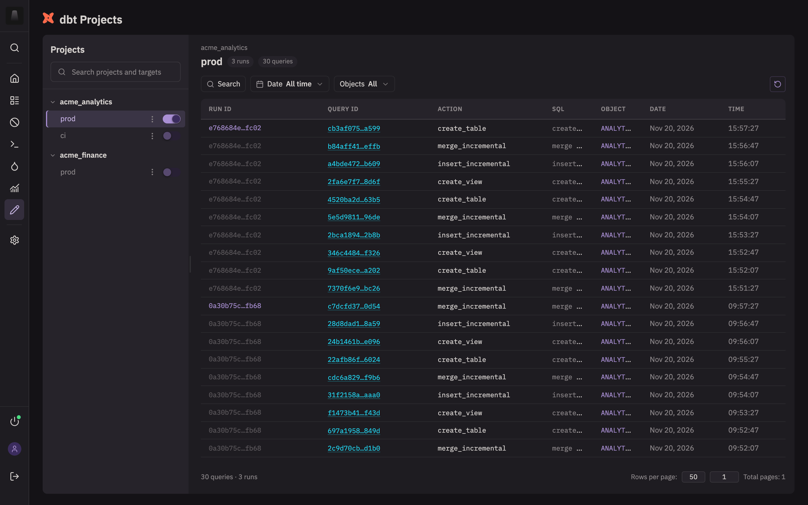

<Note>
dbt support is in private beta. The controls and behavior on this page may change. To join, ask in your shared Slack channel.
</Note>

**dbt Projects** shows the dbt projects Greybeam has seen, the targets in each project, and the queries each target ran. Use it to turn builds through Greybeam on or off for a target. Open it from the sidebar.

All roles can view this page. Only Customer Admins can change toggles and run the table actions. See [Account settings](/platform/account-settings). To connect dbt to Greybeam, see [Connect dbt](/connect/dbt). This page covers the platform controls only.

<Frame>
  
</Frame>

## How projects and targets appear

Greybeam creates entries as dbt runs through it. You don't create either in the platform. The page is empty until a dbt client has run through Greybeam.

- **Project** — The project name dbt sends with its queries.
- **Target** — A dbt target name inside that project, such as `dev` or `prod`.

## Browse targets and queries

### Projects pane

The left pane, **Projects**, lists projects and their targets. Use **Search projects and targets** to filter, and click a project to expand or collapse it. Drag the divider to resize the pane.

Each target row has:

- A **toggle** — the routing gate for the target.
- A menu (the three-dot button) with table actions.
- An **Error** badge if the last change didn't save.

### Target activity

Click a target to see its activity on the right: the project name, the target name, counts of runs and queries, and a **Target off** badge when the toggle is off. The queries table has these columns:

- **Run ID** — The dbt run. Queries from one `dbt run` share a run ID.
- **Query ID** — The query. Click a row to open its [query details](/platform/query-details).
- **Action** — What the query did.
- **SQL** — A preview of the SQL.
- **Object** — The table the query operated on, or **No object**.
- **Date** and **Time** — When it ran.

Filter by date range, by **Objects** (**All** or **Missing object**), or search by **Query ID** or **Object**. Click the refresh button to reload.

## Turn a target on or off

The target toggle decides whether builds under that target may run through Greybeam.

<Steps>
  <Step title="Click the toggle">
    Click the toggle on the target's row.
  </Step>
  <Step title="Confirm">
    Confirm **Enable target** or **Disable target** in the dialog.
  </Step>
</Steps>

- **Turning a target on** lets its tables build through Greybeam. It also enables tables you haven't configured. Tables you set yourself keep their setting.
- **Turning a target off** stops every table in it from building through Greybeam. It doesn't change your per-table choices. dbt keeps building those tables in Snowflake as usual.

## Per-table settings

Each table has one of three states:

- **Enabled** — The table builds through Greybeam when its target is on.
- **Disabled** — The table never builds through Greybeam.
- **Non-configured** — You haven't chosen. It follows the target: on when the target is on.

For a table to build through Greybeam, its target must be on, and the table must be enabled or non-configured.

To set a table, open it in [Objects Explorer](/platform/objects-explorer) and go to the **dbt Project** tab. It shows:

- The project and the **Target**.
- Whether the target is on (**Target Enabled**).
- **Build on GreyBT**, which you set to **Enabled** or **Disabled**. A table you haven't configured shows **Enabled** there.
- **Latest Query**, which links to the table's most recent query.

## Change every table in a target

Open the target's three-dot menu:

- **Enable iceberg for all tables** — Sets every table in the target to enabled.
- **Disable iceberg for all tables** — Sets every table in the target to disabled.

Confirm **Enable all** or **Disable all**. These actions set an explicit choice on every table currently in the target. Tables that join the target later are non-configured and follow the target.

<Warning>
Both actions overwrite each table's own setting, including settings you made on purpose. To pause everything and keep those settings, turn the target off instead.
</Warning>

## Related

<CardGroup cols={2}>
  <Card title="Connect dbt" icon="plug" href="/connect/dbt">
    Point dbt at Greybeam and enable builds.
  </Card>
  <Card title="Objects Explorer" icon="table" href="/platform/objects-explorer">
    Set a table's dbt build option.
  </Card>
</CardGroup>
