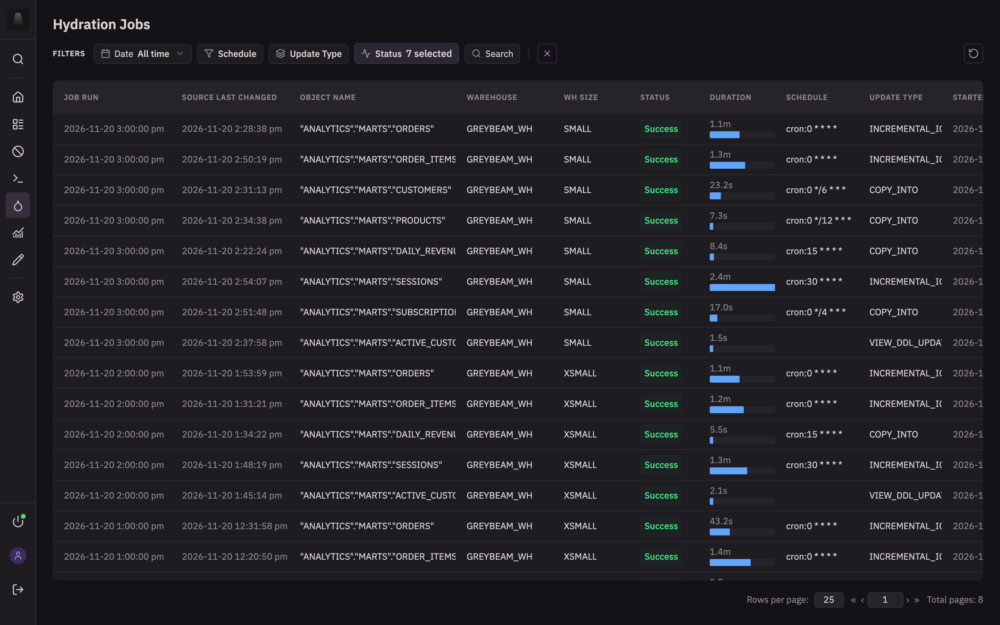

**Hydration Jobs** lists each time Greybeam checked or refreshed a table. Use it to confirm a table is fresh, find out when it last updated, and diagnose a failure. Open it from the sidebar. All roles can view it.

The same list for a single table is on that table's **Hydration Jobs** tab in [Objects Explorer](/platform/objects-explorer).

<Frame>
  
</Frame>

## Statuses

- **Scheduled** — Queued to run.
- **Running** — In progress.
- **Success** — Finished and the table is up to date.
- **Skipped** — Usually, Greybeam checked the source table, found no change, and replicated nothing. This is normal, because Greybeam checks tables often and most checks find nothing new. A **Fast Hydration** job is also skipped when its warehouse is smaller than the table needs. Open the job and read **ERROR MESSAGE**. The page hides skipped jobs by default.
- **Failed** — The job hit an error. Open it to read the message.
- **Timed Out** — The job or one of its queries ran past a timeout set in [Settings](/platform/settings).
- **Cancelled** — Someone cancelled the job.
- **Lost** — The job has no final result.

If a table stays stale, add **Skipped** to **Status** and read the message on its newest skipped job.

## Read the list

Each row is one job. Double-click a row to open its details. Clicking an already selected row works too.

- **JOB RUN** — When the job ran.
- **SOURCE LAST CHANGED** — When the source table last changed in Snowflake.
- **OBJECT NAME** — The table or view.
- **WAREHOUSE** and **WH SIZE** — The Snowflake warehouse that did the work, and its size.
- **STATUS** — One of the [statuses](#statuses) above.
- **DURATION** — How long the job took. The bar compares it with the longest job on the page.
- **SCHEDULE** — The table's custom schedule, if it has one.
- **UPDATE TYPE** — How Greybeam refreshed the table. See below.
- **STARTED** and **FINISHED** — Start and end times.

### Update types

- **COPY INTO** — Reloads the whole table.
- **CDC (Refresh)** and **CDC (Merge)** — Replicates only the rows that changed.
- **CDC (Redownload: Dynamic)** and **CDC (Redownload: Incremental)** — Reloads a CDC table in full.
- **Direct Iceberg Import** — Reads an Iceberg table straight from object storage.
- **View DDL Update** — Refreshes a view's definition.

The **Update Type** filter lists only types your jobs have used, with slightly different names, such as **Copy Into** and **Dynamic Iceberg Refresh**.

## Filter jobs

The filter bar has these controls:

- A date and time range.
- **Schedule** — Show **Custom only** schedules.
- **Update Type** and **Status** — Check the values to include. The **Status** filter calls the success status **Completed**, while the status badge says **Success**.
- **Object** — Search by table name.
- **Clear all filters** (**X**) and **Refresh**.

To see checks that found no change, add **Skipped** to **Status**. Results are paged, 25 per page by default. The filters are saved in the page address, so you can share a filtered view.

## Open a job

Double-click a row. The **Hydration Job Details** window shows:

- **STATUS**, **JOB RUN**, **SOURCE LAST CHANGED**, and the object's name and type.
- **WAREHOUSE** and **WAREHOUSE SIZE**. **Default** means no override.
- **TRIGGER TYPE** — What started the job, such as **Scheduled update**, **Staleness hydration**, **Frontend Update**, **Frontend Redownload**, or **Fast Hydration**.
- **UPDATE TYPE**, plus statistics. A COPY INTO job lists rows unloaded and bytes. CDC jobs list rows inserted, **Updated/Copied**, and deleted.
- **ERROR MESSAGE**, when the job failed or was skipped for a reason other than no changes.

## Diagnose a failed job

<Steps>
  <Step title="Filter to the problem">
    On **Status**, keep **Failed**, **Timed Out**, and **Lost** checked and open the newest row for the table. If the table is stale and none of these show up, also check **Skipped**.
  </Step>
  <Step title="Read the error">
    Check **ERROR MESSAGE**, **UPDATE TYPE**, and **TRIGGER TYPE**. Errors from Snowflake, such as missing access or a dropped table, usually name the cause.
  </Step>
  <Step title="Fix the cause">
    - **Access or object errors:** fix the grant or object in Snowflake. See [Inactive versus untracked](/platform/objects-explorer#inactive-versus-untracked).
    - **Skipped with a warehouse message:** the **Fast Hydration** warehouse is smaller than the table needs. The table stays pending until a large enough warehouse runs. Choose a larger warehouse in **Settings** > **Hydration**.
    - **Timed Out:** the job or a query exceeded **Hydration Job Timeout** or **Hydration Query Timeout** in **Settings** > **Hydration**. A large table may need a larger warehouse size.
  </Step>
  <Step title="Run it again">
    A Customer Admin opens the table in [Objects Explorer](/platform/objects-explorer), goes to **Hydration**, and clicks **Update**. Other roles don't see the **Hydration** tab, so ask a Customer Admin to retry after you've found the cause. Then check that the new job shows **Success**.
  </Step>
</Steps>

<Warning>
When a scheduled refresh query exceeds the query timeout, Greybeam turns the table off. Queries on it fall back to Snowflake until you turn it back on in **Objects Explorer**.
</Warning>

If a job keeps failing and the message doesn't explain it, ask in your shared Slack channel and include the table name and job run time.

## Related

<CardGroup cols={2}>
  <Card title="Hydration" icon="droplet" href="/how-it-works/hydration">
    How Greybeam replicates and caches your tables.
  </Card>
  <Card title="Objects Explorer" icon="table" href="/platform/objects-explorer">
    Per-table hydration, schedules, and the **Update** button.
  </Card>
  <Card title="Settings" icon="gear" href="/platform/settings#hydration">
    Schedules, timeouts, and warehouse sizes.
  </Card>
</CardGroup>
