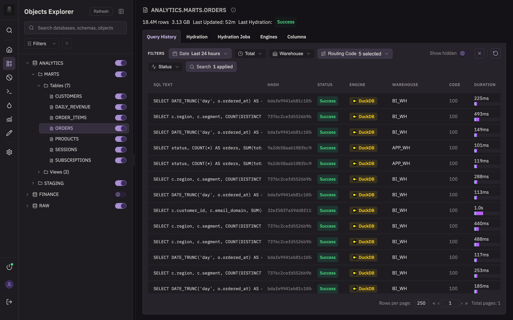
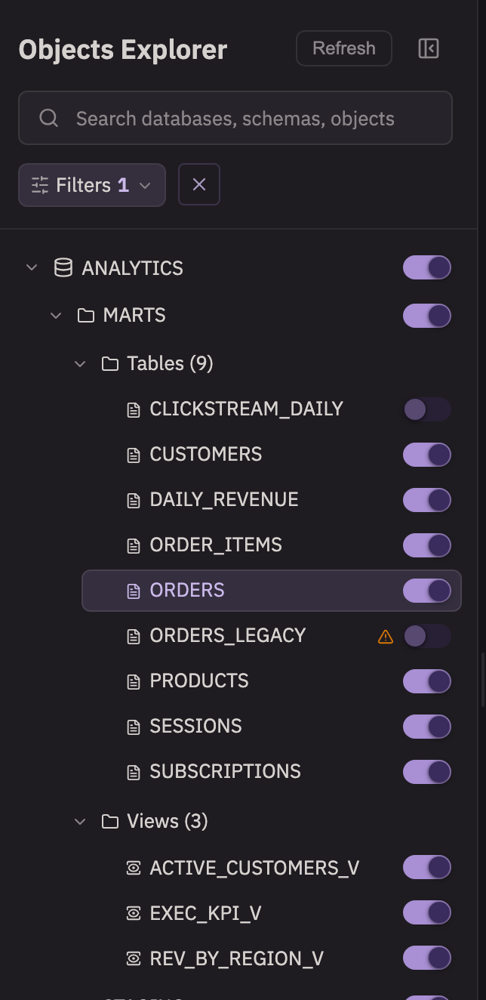
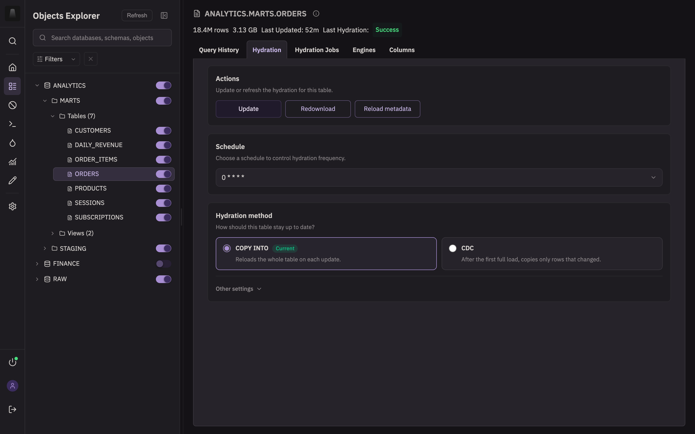
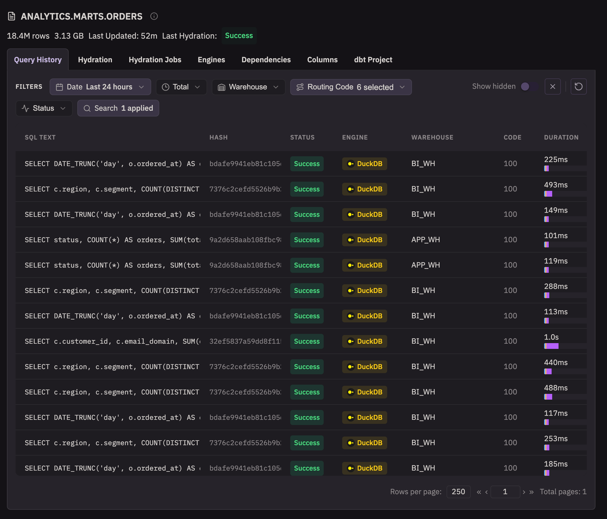
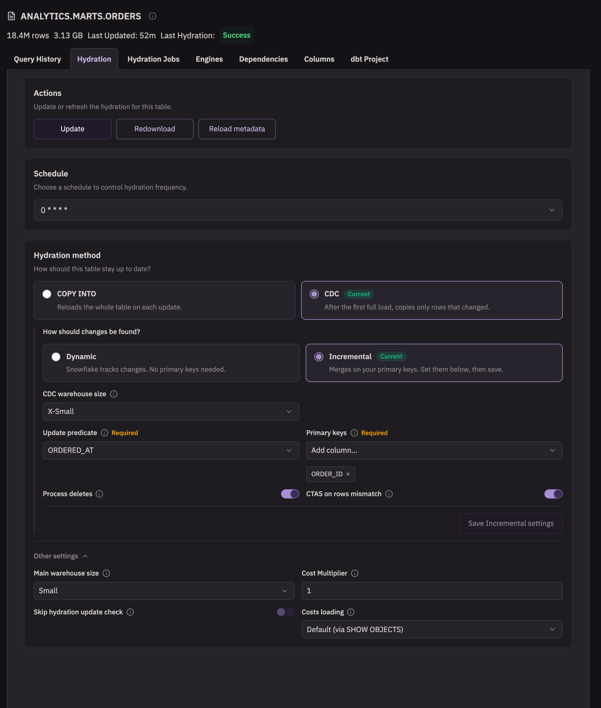
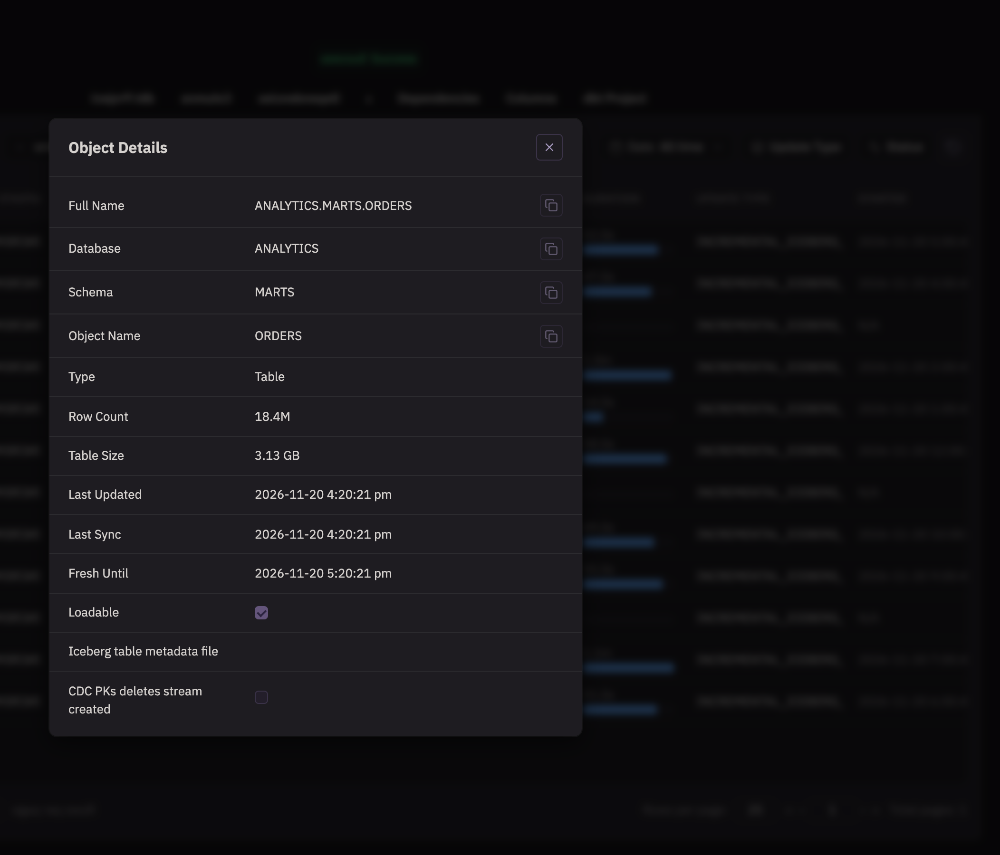
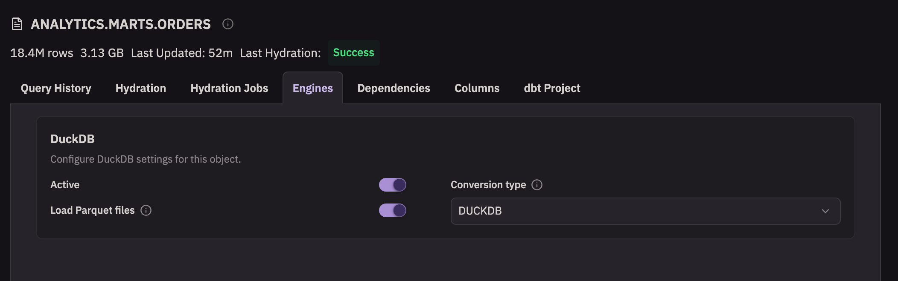
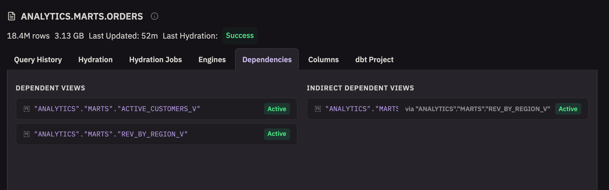
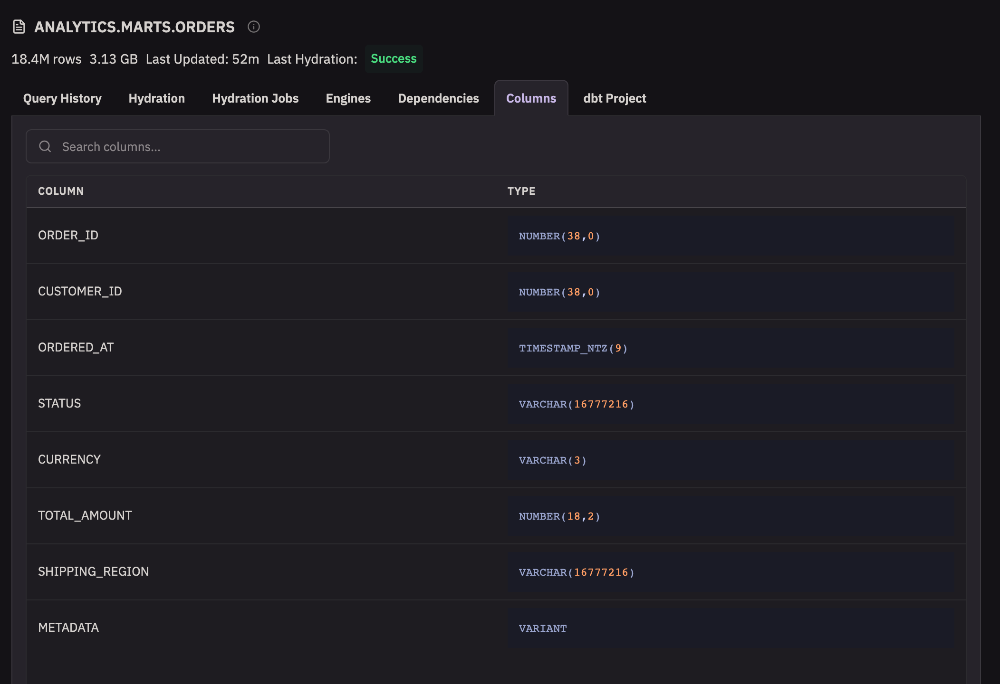
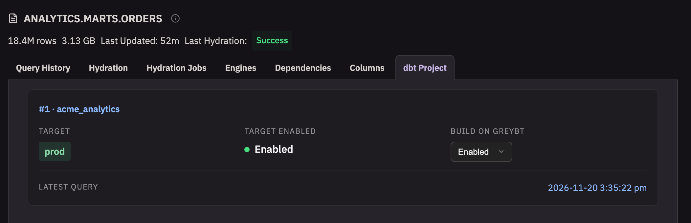

Use **Objects Explorer** to see which of your Snowflake tables Greybeam can route to DuckDB, turn tables on or off, and tune how often each one refreshes. Open it from the sidebar.

<Frame>
  
</Frame>

## Inactive versus untracked

These two states cause most routing questions. Both make a query fall back to Snowflake, but the fixes are different.

### Inactive

The Greybeam role can see the table in Snowflake, but the table is not turned on. Queries on it show routing code 301.

**Fix:** turn the table on with its toggle. See [Turn tables on or off](#turn-tables-on-or-off).

<Note>
Turning a table on tells Greybeam to hydrate it: replicate it into your S3 bucket and cache it on DuckDB workers, so queries can run there. It does not change any permissions in Snowflake.
</Note>

### Untracked

The Greybeam role can't see the table in Snowflake, so Greybeam doesn't know it exists. Queries on it show routing code 300. An untracked table never appears in Objects Explorer. Its name shows in the [query details](/platform/query-details) for the query, but without a link.

**Fix:** grant the Greybeam role access in Snowflake.

<Steps>
  <Step title="Find the role">
    Open **Settings** > **Connection** and read **Role**. See [Settings](/platform/settings).
  </Step>
  <Step title="Grant access">
    In Snowflake, grant that role access to the database, schema, or table.
  </Step>
  <Step title="Wait for the next load">
    Or run **Load all objects** from **Settings** > **Actions** if you can see it. Then turn the table on.
  </Step>
</Steps>

Whether to grant access is your call. Weigh how many queries touch the table against how much data you'd keep in sync. For routing code details, see [Routing codes](/reference/routing-codes).

## Browse and find objects

The left pane is a tree: databases, then schemas, then folders of objects. Folders include **Tables**, **Views**, **Iceberg Tables**, and **Looker PDT Datasets**. Click a database or schema to see its counts in the details panel.

- **Search databases, schemas, objects** — filters the tree by name.
- **Filters** — opens the filter menu. The badge shows how many filters are on.
- **Clear all filters** (**X**) — resets every filter.
- **Refresh** — reloads the tree and the selected object.

A warning icon with **Not found in Snowflake** marks an object that was removed from Snowflake after Greybeam saw it.

<Tip>
**What you can do:** if you can't find a table, check that its database is turned on under **Settings** > **Database** (**Load Tables**). If it still isn't listed, it may be untracked.
</Tip>

### Filters

The **Filters** menu has four tabs. Click **Apply** to commit, or **Clear** to reset the open tab.

- **State** — **Active DuckDB** shows only tables that are on. **Deleted tables** includes tables no longer found in Snowflake.
- **Size** — **Size range** with **Minimum**, **Maximum**, and **Unit**.
- **Hydration** — **Custom schedule only**, and **CDC strategy**: **Disabled**, **Dynamic Iceberg**, **Incremental Iceberg**.
- **Type** — **Tables**, **Iceberg tables**, **Views**, **Sigma datasets**, **Looker PDTs**.

## Turn tables on or off

Each table row has a toggle. Turn it on to have Greybeam hydrate the table for DuckDB. Turn it off and queries on that table fall back to Snowflake.

<Steps>
  <Step title="Find the table">
    Search or expand the tree, then click the table to open its details.
  </Step>
  <Step title="Switch it on">
    Use the toggle on the table's row, or the **Active** toggle on the **Engines** tab.

    <Frame>
      
    </Frame>
  </Step>
  <Step title="Confirm the first load">
    Open the **Hydration Jobs** tab and wait for a **Success** status. See [Hydration jobs](/platform/hydration-jobs).
  </Step>
</Steps>

Until a table's first load finishes, its queries run on Snowflake with routing code [313](/reference/routing-codes#313-tables-data-is-stale-or-not-route-ready).

Database and schema rows have toggles too. They ask you to confirm, then turn on or off every object in that scope. With a search or filter active, they change only the objects that match.

Only Customer Admins can turn tables on or off and change table settings. Other roles see the toggles but can't change them. See [Account settings](/platform/account-settings).

<Tip>
Leaving a very large table off is a valid choice. Its queries fall back to Snowflake, and you avoid the load and refresh cost. These show up as **inactive** bounces in [Analytics](/platform/analytics).
</Tip>

## Table details

Click a table to open its details panel. The header shows the table name, row count, size, **Last Updated**, and **Last Hydration** status. Click the name for more fields, such as **Last Sync** and **Fresh Until**.

<Frame>
  
</Frame>

The **Table size** you see is what Greybeam uses when it adds up the **Cost** column. It isn't bytes scanned.

Which tabs you see depends on the object and your role.

### Query History tab

Shows past queries that touched this table. Use it to check whether queries on the table run on DuckDB or fall back.

<Frame>
  
</Frame>

### Hydration tab

Controls how and when this table refreshes. Only Customer Admins see it. It has these parts.

<Frame>
  
</Frame>

#### Update now

**Actions** run an update right away:

- **Update** — replicates the latest data from Snowflake.
- **Redownload** — reloads the whole table.
- **Reload metadata** — refreshes the row count and size (and, for views, the dependencies and DDL).

#### Schedule

**Schedule** sets how often this table refreshes. A table on a schedule other than **Default** counts as a custom schedule in the filters.

<Steps>
  <Step title="Open the schedule">
    Click the **Schedule** field.
  </Step>
  <Step title="Choose a type">
    - **Default** — use the account-wide schedule from [Settings](/platform/settings).
    - **Cron** — a cron expression (minute, hour, day, month, day of week). You can add several.
    - **Interval** — every N seconds, minutes, or hours.
    - **Never** — don't refresh on a schedule.
  </Step>
  <Step title="Save">
    Click **Apply**.
  </Step>
</Steps>

#### Hydration method

**Hydration method** decides what each refresh replicates.

- **COPY INTO** — reloads the whole table on each update.
- **CDC** — reloads once, then replicates only rows that changed. CDC isn't available for every object, and not for tables with 0 rows.

With **CDC**, choose how Greybeam finds changes:

- **Dynamic** — Snowflake tracks changes. No primary keys needed.
- **Incremental** — merges on primary keys you set, plus an update predicate column.

<Steps>
  <Step title="Choose CDC">
    Select **CDC** under **Hydration method**.
  </Step>
  <Step title="Pick Incremental">
    Select **Incremental**. **Dynamic** saves as soon as you pick it.
  </Step>
  <Step title="Set the keys">
    Choose the **Primary keys** and the update predicate column. Both are required.
  </Step>
  <Step title="Save">
    Click **Save Incremental settings**.
  </Step>
</Steps>

#### Other settings

Expand **Other settings** for these:

- **Main warehouse size** — the Snowflake warehouse size for this table's refreshes. **Default** uses the account setting.
- **Skip hydration update check** — refreshes the table every time instead of first checking whether the source changed.
- **Costs loading** — how Greybeam records the table's row count and size.
- **Cost Multiplier** — scales the table's size when Greybeam estimates query cost.

<Warning>
Refreshing more often, using a larger warehouse, or skipping the update check all raise the Snowflake credits Greybeam uses. A refresh that finds no change is recorded as **skipped** and replicates nothing, but a shorter schedule still means more checks and more refreshes whenever the source changes. Pick the slowest schedule that meets your freshness needs.
</Warning>

#### Iceberg tables

Iceberg tables get an **Iceberg** card on this tab.

- **Data source** — **Snowflake** (Greybeam hydrates the data through Snowflake) or **Iceberg object storage** (Greybeam reads the data directly from storage).
- Catalog details — such as **Catalog name** and **External volume**.

With **Iceberg object storage**, the **Hydration method** card tells you to set the data source to **Snowflake** first. For the full flow with an external catalog, see [External tables](/reference/external-tables).

### Hydration Jobs tab

Lists every refresh attempt for this table, with the same statuses and job details as the [Hydration jobs](/platform/hydration-jobs) page, in a shorter column list for this table. Use it to confirm a first load or find out why a refresh failed.

<Frame>
  
</Frame>

Filter by date range, **Update Type**, and **Status**, and click **Refresh** to reload. Skipped jobs are hidden by default. Add **Skipped** to **Status** to see checks that found no change.

### Engines tab

Holds the **Active** toggle, the same switch as on the table's row. Only Customer Admins see this tab.

<Frame>
  
</Frame>

Admins can also set:

- **Load Parquet files** and **Conversion type** (**DISABLED**, **DUCKDB**, **DUCKLAKE**) — control whether and how the DuckDB workers cache the table.
- **Iceberg download mode** for Iceberg tables — **Direct files download** or **DuckDB COPY session**.

<Warning>
Turning off both **Load Parquet files** and conversion can stop a large table from loading. Leave these at their defaults unless Greybeam asks you to change them.
</Warning>

### Dependencies tab

Shows the views and tables this object reads from or feeds. The tab appears only when the object has dependencies.

<Frame>
  
</Frame>

### View DDL tab

Appears only when you select a view. It shows the view's definition in two sub-tabs: **Snowflake DDL** and **DuckDB DDL**.

### Columns tab

Lists the table's columns and their types. Use **Search columns...** to filter.

<Frame>
  
</Frame>

### dbt Project tab

Appears when dbt builds this table. Use it to decide whether the table builds through Greybeam. It shows:

- The project, with a link to [dbt Projects](/platform/dbt-projects).
- **Target** and **Target Enabled** — the dbt target, and whether it's on.
- **Build on GreyBT** — **Enabled** or **Disabled**.
- **Latest Query** — a link to the table's most recent dbt query.

<Frame>
  
</Frame>

<Steps>
  <Step title="Open the tab">
    Select the table, then click **dbt Project**.
  </Step>
  <Step title="Set Build on GreyBT">
    Choose **Enabled** or **Disabled**. Only Customer Admins can change it.
  </Step>
</Steps>

For how targets and tables work together, see [dbt Projects](/platform/dbt-projects).

## Troubleshooting

### Queries still fall back after I turned a table on

Check **Last Hydration** in the details header. If the first load hasn't finished or it failed, queries keep falling back. Open the **Hydration Jobs** tab to see why.

### A table turned itself off

Greybeam turns a table off when a scheduled refresh query exceeds its timeout. Fix the cause, then turn the table back on. See [Hydration jobs](/platform/hydration-jobs).

### The toggle is greyed out

Your role can't change tables. Ask a Customer Admin.

## Related

<CardGroup cols={2}>
  <Card title="Hydration jobs" icon="arrows-rotate" href="/platform/hydration-jobs">
    Read refresh history and diagnose failures.
  </Card>
  <Card title="Settings" icon="gear" href="/platform/settings">
    Set account-wide refresh schedules and warehouse sizes.
  </Card>
  <Card title="External tables" icon="cloud" href="/reference/external-tables">
    Set up an external Iceberg catalog.
  </Card>
  <Card title="dbt Projects" icon="diagram-project" href="/platform/dbt-projects">
    Control dbt builds by target.
  </Card>
</CardGroup>
