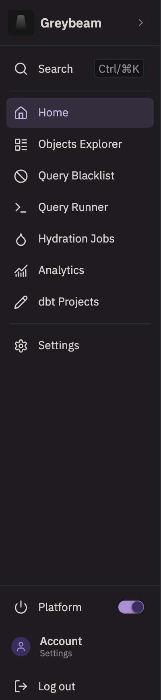

The Greybeam platform shows where each of your queries ran and why. Use this page to find your way around it: what each page is for, how to navigate, and who can see what.

You sign in at `https://demo.admin.greybeam.ai`.

## How Greybeam works

- Your Snowflake clients connect to your Greybeam compute endpoint instead of Snowflake, as long as they use a [supported driver](/connect/drivers).
- Greybeam checks every query. If a query can run on DuckDB, Greybeam runs it there.
- If it can't, or if DuckDB fails, the query falls back to your own Snowflake account (a **Snowflake bounce**). Either way, your client gets a normal Snowflake response.
- Greybeam replicates your tables into your S3 bucket, caches them on DuckDB workers, and keeps them in sync with Snowflake (**hydration**).
- Every query gets a **routing code** that says where it ran and why.

The platform is where you see that happen. Use it to debug individual queries, find out why queries fell back to Snowflake, and decide what to change so more queries can run on DuckDB. The Greybeam team also monitors your platform and works to raise your routing rate.

For the full picture, see [Query routing](/how-it-works/query-routing).

## Pages in the platform

Each page below has its own entry in the sidebar.

### Watch your queries

<CardGroup cols={2}>
  <Card title="Home" icon="clock-rotate-left" href="/platform/query-history">
    Query history: every query that passed through Greybeam, where it ran, and why.
  </Card>
  <Card title="Analytics" icon="chart-line" href="/platform/analytics">
    Charts for routing rate, Snowflake bounces, cache, latency, and warehouse spend. Hover over it in the sidebar to open its two pages, **Queries** and **Warehouse Costs**.
  </Card>
</CardGroup>

### Control what runs on DuckDB

<CardGroup cols={2}>
  <Card title="Objects Explorer" icon="table" href="/platform/objects-explorer">
    Browse your Snowflake databases, schemas, tables, and views, and choose which tables Greybeam hydrates for DuckDB.
  </Card>
  <Card title="Hydration Jobs" icon="arrows-rotate" href="/platform/hydration-jobs">
    Inspect the jobs that replicate your tables and keep them current.
  </Card>
  <Card title="Query Blacklist" icon="ban" href="/platform/query-blacklist">
    Review queries that always run on Snowflake instead of DuckDB.
  </Card>
  <Card title="dbt Projects" icon="diagram-project" href="/platform/dbt-projects">
    Manage dbt projects and models.
  </Card>
</CardGroup>

### Run SQL and manage settings

<CardGroup cols={2}>
  <Card title="Query Runner" icon="terminal" href="/platform/query-runner">
    Write and run SQL against DuckDB or Snowflake.
  </Card>
  <Card title="Settings" icon="gear" href="/platform/settings">
    Configure your Snowflake connection, compute endpoint, and data settings.
  </Card>
  <Card title="Account Settings" icon="users" href="/platform/account-settings">
    Manage your profile, your organization, and its members. Shown as **Account** in the sidebar footer.
  </Card>
</CardGroup>

## The sidebar

<Columns cols={2}>
<Column>

The sidebar runs down the left edge of every page. By default it's collapsed to icons. Hover over it to expand it, or click the arrow next to the **Greybeam** logo to pin it open. From top to bottom, it holds:

- **Search**, which opens [global search](#global-search).
- The page list (see [Pages in the platform](#pages-in-the-platform)).
- **Settings**, below a divider.
- The footer: the **Platform** switch (see [The platform switch](#the-platform-switch)), **Account**, **Log out**, and the platform version number.

<Note>
While your account is still being set up, the sidebar shows only **Onboarding**. See [Set up your account](/get-started/onboarding).
</Note>

</Column>
<Column>

<Frame>
  
</Frame>

</Column>
</Columns>

## Global search

Search jumps to any page you can open.

<Steps>
  <Step title="Open the palette">
    Click **Search** at the top of the sidebar, or press `Ctrl+K` (`⌘K` on macOS).
  </Step>
  <Step title="Find the page">
    Type part of a page name or a keyword, such as `blacklist` or `credits`.
  </Step>
  <Step title="Go there">
    Use the arrow keys to pick a result, then press `Enter`. Press `Esc` to close the palette.
  </Step>
</Steps>

Search lists only the pages your role can open. It also includes sections inside **Settings**.

If your role can run maintenance actions, such as **Load all objects**, they appear under the pages. The palette asks you to confirm before it runs an action.

## The platform switch

The **Platform** switch in the sidebar footer turns Greybeam routing on or off for your whole organization. It's on by default.

- **On** (tooltip: "Platform active, routing small queries to DuckDB"): Greybeam routes each query as usual.
- **Off** (tooltip: "Platform not active, routing all queries to Snowflake"): every query goes straight to your Snowflake account.

Turning it off doesn't block or break anything. Your clients keep working against the same compute endpoint and get normal Snowflake results. Queries that run while the switch is off show routing code **900** in [query history](/platform/query-history).

Use it when you want every query to run on Snowflake for a while, for any reason.

<Warning>
The switch affects every user and client in your organization, not only you.
</Warning>

<Steps>
  <Step title="Click Platform">
    Click **Platform** in the sidebar footer.
  </Step>
  <Step title="Confirm">
    Confirm the dialog ("Are you sure you want to deactivate the platform?").
  </Step>
</Steps>

Turn it back on the same way. When the sidebar is collapsed, a dot on the power icon shows the state: green for on, red for off.

## What each role can see

Your role decides which pages appear in the sidebar and search. Pages you can't use are hidden, not greyed out.

- **Customer Viewer** — **Home**, **Objects Explorer**, **Query Blacklist**, **Hydration Jobs**, **Analytics**, **dbt Projects**, and **Account Settings**.
- **Customer Developer** — everything a Customer Viewer sees, plus **Query Runner**, some sections of **Settings**, the **Platform** switch, and **Add to Blacklist** in query details.
- **Customer Admin** — everything a Customer Developer sees, plus all of **Settings** and managing organization members.

Some pages show more controls to higher roles. For example, everyone can open **Objects Explorer**, but only a Customer Admin can turn tables on or off. Each page's doc notes its role requirements.

Admins invite members and assign roles in [Account settings](/platform/account-settings).

## Related

<CardGroup cols={2}>
  <Card title="Query routing" icon="route" href="/how-it-works/query-routing">
    How Greybeam decides where each query runs.
  </Card>
  <Card title="Routing codes" icon="signs-post" href="/reference/routing-codes">
    What every routing code means and what to do about it.
  </Card>
  <Card title="Set up your account" icon="list-check" href="/get-started/onboarding">
    The onboarding wizard for a new Greybeam account.
  </Card>
</CardGroup>
