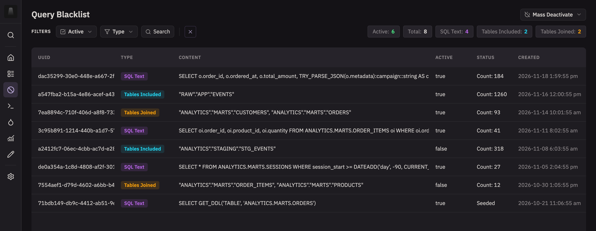

**Query Blacklist** lists the query patterns that Greybeam never runs on DuckDB. A query that matches an active entry falls back to Snowflake. Use this page to see why a query bounced, to block a query that runs badly on DuckDB, or to let a pattern try DuckDB again. Open it from the sidebar.

Every role can view this page. Customer Developers and Customer Admins can add entries, switch **Active**, and use **Mass Deactivate**. See [Account settings](/platform/account-settings).

<Frame>
  
</Frame>

## What lands here

An entry is one pattern. There are three types, and each has its own routing code in [query history](/platform/query-history).

| Type | Matches | Routing code |
| --- | --- | --- |
| **SQL Text** | A query with the same SQL text, ignoring comments. | 305 |
| **Tables Included** | Any query that reads exactly the same set of tables. | 306 |
| **Tables Joined** | Any query with exactly the same joins. | 307 |

Greybeam fingerprints queries. When a query is slow on DuckDB, Greybeam can add it to the list, so later matches fall back to Snowflake without trying DuckDB first. You can also add entries yourself.

- **Added by Greybeam** — Starts with a count. The entry starts keeping queries on Snowflake once it has been seen 3 times, and its status shows **Count: N** until then.
- **Added by you** — Shows **Seeded** and takes effect immediately.

If a query shows code 305, 306, or 307, open its [query details](/platform/query-details). The **Routing Reason** links to the matching entry here.

## Add an entry

<Steps>
  <Step title="Open the query">
    In [Query history](/platform/query-history), open a query that you want to block.
  </Step>
  <Step title="Choose what to block">
    Click **Add to Blacklist**, then pick **Originating SQL Text**, **Tables Included**, or **Tables Joined**. An option is greyed out when the query doesn't have that content.
  </Step>
  <Step title="Confirm">
    Confirm the dialog. Future queries that match no longer run on DuckDB.
  </Step>
</Steps>

<Tip>
**Tables Included** and **Tables Joined** are broader than **SQL Text**. They block every query that reads that same complete set of tables (**Tables Included**) or has that same set of table-to-table joins that Greybeam recognizes (**Tables Joined**), not just one query. Changing the relevant pattern can make a query stop matching. For example, adding a table changes **Tables Included**, but it may leave **Tables Joined** unchanged.
</Tip>

## Review the list

Each row is an entry. Double-click a row to open its details.

- **UUID** — The entry's ID.
- **TYPE** — **SQL Text**, **Tables Included**, or **Tables Joined**.
- **CONTENT** — The SQL or the table names.
- **ACTIVE** — Whether the entry is in force.
- **STATUS** — **Seeded**, or **Count** with the number of times the pattern was seen.
- **CREATED** — When the entry was added.

The row above the grid shows totals: **Active**, **Total**, **SQL Text**, **Tables Included**, and **Tables Joined**. The details window also shows the **Lookup Hash**, which is the fingerprint Greybeam matches on, and the individual tables for table-based entries.

### Filter

- **Active** — **Show only active** entries.
- **Type** — Pick **All** or specific types, then apply.
- Search by **Content (SQL/Tables)**, **UUID**, or **Lookup Hash**.
- **Clear all filters** (**X**).

## Remove an entry

You don't delete entries. You deactivate them, which lets matching queries try DuckDB again.

<Steps>
  <Step title="Open the entry">
    Find it with the filters, then double-click it.
  </Step>
  <Step title="Switch off Active">
    Turn off the **Active** toggle. You can turn it back on later.
  </Step>
</Steps>

<Warning>
Deactivating an entry sends matching queries back to DuckDB. If they were blacklisted because they ran slowly there, they will be slow again. Check the entry's **Seen** count and recent [query history](/platform/query-history) first.
</Warning>

### Deactivate many entries

Click **Mass Deactivate** at the top of the page.

<Steps>
  <Step title="Set the filters">
    Set a **Date range** (start and end dates are required). Choose the **Blacklist type** and **Seeded** (**False** or **True**).
  </Step>
  <Step title="Preview">
    Click **Preview Matches** to see how many active entries match, grouped by type. If you change a filter after previewing, preview again before you deactivate.
  </Step>
  <Step title="Apply">
    Click **Deactivate N Entries**.
  </Step>
</Steps>

## Related

<CardGroup cols={2}>
  <Card title="Query history" icon="clock-rotate-left" href="/platform/query-history">
    Find a query to block and see its routing code.
  </Card>
  <Card title="Routing codes" icon="route" href="/reference/routing-codes">
    What codes 305, 306, and 307 mean.
  </Card>
  <Card title="Account settings" icon="users" href="/platform/account-settings">
    What each role can do.
  </Card>
</CardGroup>
