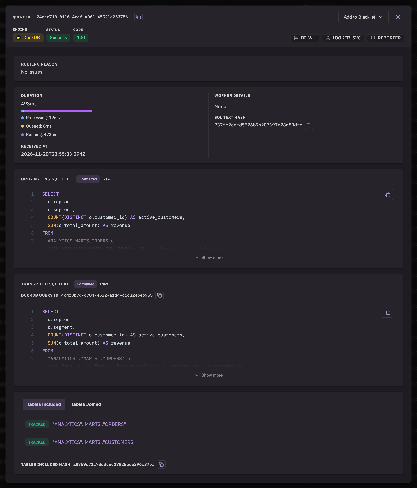

The query details view shows everything Greybeam recorded about one query: where it ran, why, how long each phase took, the SQL, and the tables involved. Use it to diagnose a single query, such as one that fell back to Snowflake or ran slowly.

## Open and close it

In [query history](/platform/query-history) on **Home**, double-click a row. (Technically, the first click selects the row and the second opens it.) The details open in a panel over the page.

To close it, click the **X** at the top right, click outside the panel, or press `Esc`.

The header holds the **Query ID**, **Engine**, **Status**, **Code**, the session chips, and **Add to Blacklist**. Below it are the routing reason, timing, SQL, and tables.

<Frame>
  
</Frame>

## Identify the query

- **Query ID** — Greybeam's ID for this query. Click the copy icon to copy it. Paste it into the **Query ID** search on **Home** to find the query again, or share it with Greybeam support.
- **SQL Text Hash** — the fingerprint of the SQL text. It's the same value as the **HASH** column in query history. Copy it and use **Search** > **Hash** on **Home** to find every run of this SQL. Greybeam ignores SQL comments when it computes the hash, so queries that differ only in their comments share a hash.
- Warehouse, user, and role chips — the Snowflake warehouse, user, and role from the client's session. The warehouse and role chips appear only when the session set them.

## Why it ran where it did

- **Engine** — where the query ran: **DuckDB** or **Snowflake**.
- **Status** — **Success**, **Failure**, **Processing**, **Queued**, **Running**, **Aborted**, or **Unknown**. See [Statuses](/platform/query-history#statuses).
- **Code** — the routing code. Hover over it for the description. The pill is red for 8xx codes (DuckDB failed), orange for 3xx and 9xx codes (DuckDB was skipped), and green for the rest.
- **Routing Reason** — the plain-language meaning of the routing code, such as "Table(s) in query not active". If a blacklist entry sent the query to Snowflake, this is a link that opens the matching entry in [Query Blacklist](/platform/query-blacklist).
- **Details** — extra context, when Greybeam has it. For example, for an inactive-table bounce it lists the inactive tables. Table names here are links that open the table in [Objects Explorer](/platform/objects-explorer) in a new tab.
- **ERROR MESSAGE** — if the query failed, this box appears at the top of the body with the error text.

## Timing

- **Duration** — total time, with a bar and a legend that split it into **Processing**, **Queued**, and **Running**. A long **Queued** time means the query waited for capacity.
- **Received At** — when Greybeam received the query.
- **Worker Details** — for queries that ran on DuckDB, **Connection Index**, **Pod**, and **Memory** identify the DuckDB worker that ran it. Shows **None** for queries that didn't run on DuckDB.

## SQL

- **Originating SQL Text** — always shown. The SQL your client sent, in Snowflake dialect. Shows the **Snowflake Query ID** when there is one.
- **Transpiled SQL Text** — shown when Greybeam translated the query. The same query translated into DuckDB dialect. Shows the **DuckDB Query ID** when DuckDB ran it.
- **Bind Variables** — shown when the query used bind variables. The bound values, as JSON.

A query that Greybeam never translated, such as one sent straight to Snowflake, has no **Transpiled SQL Text**.

Each section has a copy button and a **Show more** / **Show less** toggle for long SQL. SQL sections also have a **Formatted** / **Raw** toggle: **Formatted** reflows the SQL for reading, **Raw** shows it exactly as received.

<Tip>
To rerun a query yourself, copy the **Originating SQL Text** or **Transpiled SQL Text** into [Query Runner](/platform/query-runner). There you can choose to run it on DuckDB or Snowflake and compare.
</Tip>

## Tables

The tables card at the bottom has two tabs.

**Tables Included** lists every table the query references.

- **Tracked** tables are ones Greybeam can see in Snowflake. Each name links to the table in [Objects Explorer](/platform/objects-explorer), where you can check whether it's active and turn it on. If the object is a view, the tables it depends on are listed beneath it.
- **Untracked** tables appear, without a link, when the query fell back because Greybeam's role can't see them (code `300`). Greybeam doesn't know whether these tables exist, so there's nothing to link to.
- For queries that ran on DuckDB, a tracked table's name can be followed by its load state on the DuckDB workers, such as **Downloaded** or **Converted**. `NOT LOADED!` means DuckDB didn't have the table loaded.

**Tables Joined** lists each pair of tables the query joins, shown as `left_table -> right_table`.

Each tab ends with a hash (**Tables Included Hash** or **Tables Joined Hash**). Greybeam uses these to match blacklist entries for the same set of tables or joins.

## Add a query to the blacklist

**Add to Blacklist** keeps future matching queries off DuckDB, so they run on Snowflake. Use it for a query that's slow or fails on DuckDB.

You need the Customer Developer or Customer Admin role. The button is hidden if the query was already blocked by a blacklist entry.

<Warning>
**Tables Included** and **Tables Joined** are broad; they can block many different queries.
</Warning>

<Steps>
  <Step title="Choose what to match">
    Click **Add to Blacklist**, then choose one option. An option is greyed out when the query doesn't have that content.

    - **Originating SQL Text**: only queries with this SQL. Comments are ignored, so queries that differ only in comments also match.
    - **Tables Included**: any query that references this same set of tables.
    - **Tables Joined**: any query with these same joins.
  </Step>
  <Step title="Confirm">
    The dialog asks you to confirm, for example: "Future queries matching this will no longer run on DuckDB." Click **Confirm**. A message under the header confirms the entry was added.
  </Step>
</Steps>

To review or remove entries, go to [Query Blacklist](/platform/query-blacklist).

## Diagnose a query

Start with the **Code**, then find the matching entry below. Code `100` with **Engine** DuckDB means the query ran on DuckDB with no issues, so there's nothing to do.

When you ask Greybeam about a query, include its **Query ID**. For every routing code, see [Routing codes](/reference/routing-codes).

### Code 301: Details lists inactive tables

Greybeam can see the tables, but they aren't turned on.

<Tip>
**What you can do:** click a table name and turn it on in [Objects Explorer](/platform/objects-explorer). Future queries can then run on DuckDB.
</Tip>

### Code 300: Untracked tables listed

Greybeam's role has no access to those tables in Snowflake.

<Tip>
**What you can do:** decide whether to grant the Greybeam role access. See [Objects Explorer](/platform/objects-explorer).
</Tip>

### Code 305, 306, or 307

A blacklist entry matched.

<Tip>
**What you can do:** click the **Routing Reason** link to see the entry. See [Query Blacklist](/platform/query-blacklist).
</Tip>

### An 8xx code with an error message

DuckDB tried and failed, so the query fell back to Snowflake. Greybeam ran it on Snowflake and returned Snowflake's result or error.

<Tip>
**What you can do:** compare **Originating SQL Text** with **Transpiled SQL Text**. If it keeps happening, consider **Add to Blacklist** and tell Greybeam in your shared Slack channel.
</Tip>

### A long Queued segment in Duration

The query waited for capacity.

<Tip>
**What you can do:** if it's frequent, tell Greybeam in your shared Slack channel.
</Tip>

### Code 900

The **Platform** switch was off. See [The platform switch](/platform/overview#the-platform-switch).

## Related

<CardGroup cols={2}>
  <Card title="Query history" icon="clock-rotate-left" href="/platform/query-history">
    Find and filter the queries you want to inspect.
  </Card>
  <Card title="Routing codes" icon="signs-post" href="/reference/routing-codes">
    What every routing code means and what to do about it.
  </Card>
  <Card title="Query Blacklist" icon="ban" href="/platform/query-blacklist">
    Review and remove blacklist entries.
  </Card>
  <Card title="Query Runner" icon="terminal" href="/platform/query-runner">
    Rerun a query on DuckDB or Snowflake and compare.
  </Card>
</CardGroup>
