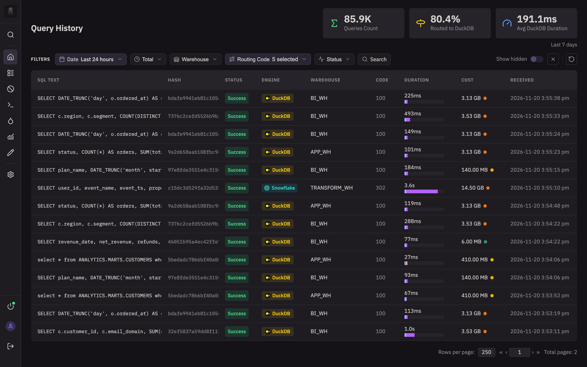

**Home** shows your query history: every query your clients sent through Greybeam, which engine ran it, and its routing code. Use it to spot queries that fell back to Snowflake, failed, or ran slowly, and to open any query for a closer look.

Click **Home** in the sidebar. The page is titled **Query History**.

<Frame>
  
</Frame>

## Summary cards

Three cards sit at the top right. They cover the **Last 7 days**, whatever filters you set below.

- **Queries Count** — total queries Greybeam received.
- **Routed to DuckDB** — share of queries that DuckDB answered successfully, including answers served from the results cache.
- **Avg DuckDB Duration** — average duration of queries that ran on DuckDB.

Click any card to open [Analytics > Queries](/platform/analytics) for the full charts.

## Columns

Each row is one query, newest first. Rows for queries that are still in progress are styled differently from finished ones.

**Identify the query**

- **SQL TEXT** — the SQL your client sent.
- **HASH** — a fingerprint of the SQL text. Identical SQL gets the same hash (comments are ignored), so you can use it to find repeats of the same query.
- **RECEIVED** — when Greybeam received the query, in your browser's time zone.

**Where and how it ran**

- **ENGINE** — where the query ran: **DuckDB** or **Snowflake**.
- **WAREHOUSE** — the Snowflake warehouse set on the client's session.
- **STATUS** — where the query is in its lifecycle. See [Statuses](#statuses).
- **CODE** — the routing code. Hover over it to see what it means. See [Routing codes](#routing-codes).

**Time and size**

- **DURATION** — total time for the query, with a bar showing where the time went. See [Duration bars](#duration-bars).
- **COST** — the combined size of the tables the query references, not data scanned or a charge. See [The Cost column](#the-cost-column).

### Statuses

- **Success** — the query finished and returned results.
- **Failure** — the query finished with an error. Open it to read the error message.
- **Processing** — Greybeam has received the query and hasn't queued or started it yet.
- **Queued** — the query is waiting to start.
- **Running** — the query is executing.
- **Aborted** — the query was canceled.
- **Unknown** — Greybeam never received a final result for the query.

### Routing codes

The **CODE** column shows a number that explains where the query ran and why. Hover over it to see a short description, such as "No issues" for `100` or "Table(s) in query not active" for `301`.

Codes are grouped by their first digit:

- **1xx** — ran on DuckDB.
- **2xx** — sent to Snowflake because DuckDB doesn't handle that kind of request, such as DDL or metadata queries.
- **3xx** — could run on DuckDB, but something prevented it, such as an inactive table or a blacklist entry.
- **7xx** — routing was forced.
- **8xx** — Greybeam tried DuckDB, it failed, and the query fell back to Snowflake.
- **9xx** — Greybeam routing was switched off. `900` means the **Platform** switch was off.

For every code and what to do about it, see [Routing codes](/reference/routing-codes).

### Duration bars

The **DURATION** bar splits a query's time into phases:

- Blue: **Processing**
- Orange: **Queued**, time spent waiting to start. Queries queue when many arrive at once.
- Purple: **Running**

Hover over the bar to see each phase's time. Bar length is relative to the longest query on the current page, so you can spot slow queries at a glance. When phase timing isn't available, the bar is one solid block.

## The Cost column

<Warning>
**COST is not bytes scanned and not a dollar amount.** Today it's the combined size of all the tables the query references, shown in bytes (KB, MB, GB, TB). It doesn't depend on how much data the query actually read.

For example, a query that touches a 200 GB table shows **200.00 GB**, even if a filter meant it scanned only a few MB.
</Warning>

The colored marker next to the value goes from green (small) to red (200 GB or more). Treat it as a rough signal of how large a query's tables are, not as what the query cost you.

If a table has a **Cost Multiplier** set in [Objects Explorer](/platform/objects-explorer), its size is scaled by that multiplier.

Greybeam is moving this column to measure actual bytes scanned. For Snowflake spend, use [Analytics > Warehouse Costs](/platform/analytics#warehouse-costs).

## Filters

The filter bar sits above the grid. Each filter shows as a pill; a highlighted pill means that filter is narrowing the results. Click a pill to open it, then click **Apply**. **Clear** inside a pill resets that filter.

- **Date** — time range. Defaults to **Last 24 hours**. See [Time ranges](#time-ranges).
- Duration (shows **Total** until you set it) — keep queries above a **Minimum**, below a **Maximum**, or both. Choose the **Duration type** (**Total**, **Processing**, **Queued**, or **Running**) and the **Unit** (milliseconds, seconds, or minutes).
- **Warehouse** — keep queries from selected Snowflake warehouses.
- **Routing Code** — keep queries with selected routing codes. See [Find out why a query ran on Snowflake](#find-out-why-a-query-ran-on-snowflake).
- **Status** — keep queries with selected statuses.
- **Search** — search by **SQL Text**, **Username**, **Warehouse**, **Error**, **Hash**, or **Query ID**. See [Search fields](#search-fields).

Your filters are saved in the page URL, so you can bookmark a filtered view or share it with a teammate.

<Note>
By default, the **Routing Code** filter leaves out three kinds of background queries: `201` (metadata queries), `202` (transaction queries), and `211` (describe queries). To see them, open **Routing Code**, select them, and click **Apply**.
</Note>

### Time ranges

Open **Date** and pick a tab:

- **Relative** — under **Quick select**, choose **Last 15 minutes**, **Last hour**, **Last 6 hours**, **Last 24 hours**, or **Last 48 hours**. Or under **Custom**, set **Last** _n_ **minutes**, **hours**, or **days**. Click **Apply**.
- **Date range** — pick a start and end date and time.

### Search fields

Text fields match any part of the value and ignore case.

- **SQL Text** also matches the translated DuckDB SQL and the names of tables the query references.
- **Query ID** needs a full query ID or DuckDB query ID.

### Show hidden, reset, and refresh

These controls sit on the right of the filter bar:

- **Show hidden** — include queries that are hidden by default. These are background queries, such as table existence checks that BI tools send (routing code `311`).
- **X** (Reset all filters) — appears once you've changed a filter. Click it to return every filter to its default.
- **Refresh** — reload the list. The page doesn't update on its own, so click **Refresh** to see new queries.

## Pages and sorting

The grid shows 250 queries per page by default. Use the pager below the grid to move between pages or type a different page size.

Columns can't be sorted; the list is always newest first. To narrow it, use the filters.

## Open a query

Click a row to select it, then click it again to open its [query details](/platform/query-details). In practice, double-click the row.

Close the details with the **X**, by clicking outside, or with `Esc`.

## Find out why a query ran on Snowflake

<Steps>
  <Step title="Filter to Snowflake bounces">
    Open **Routing Code**. The list shows each code that appears in your current results, with its description, such as `301 - Table(s) in query not active`. Click **Show all options** to list every code. Select the codes you care about, or start with the 3xx and 8xx codes, and click **Apply**.
  </Step>
  <Step title="Read the code">
    Hover over a row's **CODE** to see the reason. For the fix, look the code up in [Routing codes](/reference/routing-codes).
  </Step>
  <Step title="Open the query">
    Double-click the row. The [query details](/platform/query-details) show the **Routing Reason**, any extra **Details** (such as which tables are inactive), and the tables involved, with links to each table in Objects Explorer.
  </Step>
  <Step title="Act on it">
    Common fixes: turn on an inactive table in [Objects Explorer](/platform/objects-explorer) (code `301`), grant the Greybeam role access to an untracked table (code `300`), or review a blacklist entry in [Query Blacklist](/platform/query-blacklist) (codes `305` to `307`).
  </Step>
</Steps>

To see the same reasons as a trend over time, use the **Queries Routed to Snowflake** chart in [Analytics](/platform/analytics).

## Troubleshooting

### A query I just ran isn't in the list

The list doesn't update on its own, or a filter is hiding the query.

1. Click **Refresh**.
2. Check the **Date** range, and click **X** to reset all filters.
3. Metadata, transaction, and describe queries (`201`, `202`, `211`) are filtered out by default. Some background queries only appear with **Show hidden** on.

### The COST value looks huge

**COST** shows the size of the tables the query references, so a small query on a large table shows the full table size. See [The Cost column](#the-cost-column).

### Many queries show a long orange bar

Orange is time spent queued. Queries queue when many arrive at once. If queuing is frequent, message Greybeam in your shared Slack channel.

## Related

<CardGroup cols={2}>
  <Card title="Query details" icon="magnifying-glass" href="/platform/query-details">
    Inspect one query's routing reason, timing, SQL, and tables.
  </Card>
  <Card title="Routing codes" icon="signs-post" href="/reference/routing-codes">
    What every routing code means and what to do about it.
  </Card>
  <Card title="Analytics" icon="chart-line" href="/platform/analytics">
    Routing rate, Snowflake bounces, and latency over time.
  </Card>
  <Card title="Objects Explorer" icon="table" href="/platform/objects-explorer">
    Turn on tables so more queries can run on DuckDB.
  </Card>
</CardGroup>
