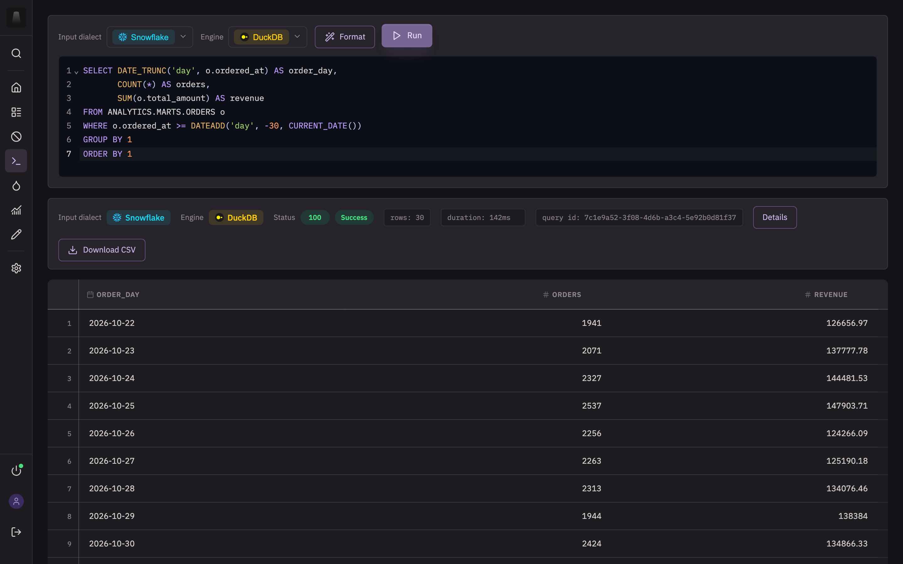

**Query Runner** is a SQL editor in the platform. Use it to run a query on DuckDB only, to check a query that fell back to Snowflake, or to compare results and timing between the two engines. Open it from the sidebar. It is available to Customer Developers and Customer Admins.

<Frame>
  
</Frame>

## Choose a dialect and an engine

Two selectors at the top control how the query runs.

- **Input dialect** — The SQL dialect you write in, **Snowflake** (default) or **DuckDB**. The editor and **Format** use it.
- **Engine** — The engine that runs the query, **DuckDB** (default) or **Snowflake**.

Greybeam translates Snowflake SQL for DuckDB. If you set **Input dialect** to **DuckDB**, **Engine** locks to **DuckDB**, because DuckDB SQL can't run on Snowflake.

| You want to | Set Input dialect | Set Engine |
| --- | --- | --- |
| Test a Snowflake query on DuckDB | **Snowflake** | **DuckDB** |
| Run the same query on Snowflake | **Snowflake** | **Snowflake** |
| Write DuckDB SQL directly | **DuckDB** | **DuckDB** (locked) |

## Run a query

<Steps>
  <Step title="Enter SQL">
    Type or paste SQL into the editor. To start from a real query, copy its SQL or transpiled SQL from [query details](/platform/query-details).

    <Note>
    Query Runner doesn't run write statements. Greybeam rejects DML, DDL, and DCL (for example `INSERT`, `CREATE`, and `GRANT`) on either engine. If you force **DuckDB** on a query whose tables are too large for DuckDB, Greybeam rejects it too.
    </Note>
  </Step>
  <Step title="Pick the dialect and engine">
    Set them as described above. Click **Format** to tidy the SQL.
  </Step>
  <Step title="Click Run">
    **Run** is disabled while the editor is empty. A timer shows while the query runs.
  </Step>
</Steps>

<Warning>
**Cancel** stops the browser from waiting. The query can keep running on the engine.
</Warning>

## Read the result

After a run, a summary row appears above the results.

- **Input dialect** and **Engine** — The dialect you used and the engine that ran the query.
- **Status** — The [routing code](/reference/routing-codes) (hover for its meaning) and whether the run succeeded.
- **rows** — Rows returned. If the result was cut off, it reads `(showing N)`.
- **duration** — How long the query took. Until the final number arrives, **elapsed** shows.
- **query id** — The query's ID.

Runs from Query Runner get a query ID and a routing code like any other query. Use the code to see how Greybeam handled it.

Below the summary:

- **Details** opens the full [query details](/platform/query-details) for the run.
- **Download CSV** exports the results. This runs the query again and streams the new run's results. The rows can differ from the grid, and the rerun counts as another query.
- The results grid supports filtering on each column.

## Common tasks

### See if a fallback query would work on DuckDB

<Steps>
  <Step title="Copy the SQL">
    Open the query in [query details](/platform/query-details) and copy its SQL.
  </Step>
  <Step title="Run it on DuckDB">
    Paste it here and run it with **Engine** set to **DuckDB**.
  </Step>
  <Step title="Check the result">
    If it succeeds, check the **Status** routing code, and compare the rows with the Snowflake result.
  </Step>
</Steps>

### Compare timing between engines

Run the query once with **Engine** set to **DuckDB** and once set to **Snowflake**. Compare **duration** in the summary.

## Related

<CardGroup cols={2}>
  <Card title="Query details" icon="magnifying-glass" href="/platform/query-details">
    Copy a query's SQL and see how Greybeam routed it.
  </Card>
  <Card title="Routing codes" icon="route" href="/reference/routing-codes">
    What each routing code means.
  </Card>
</CardGroup>
