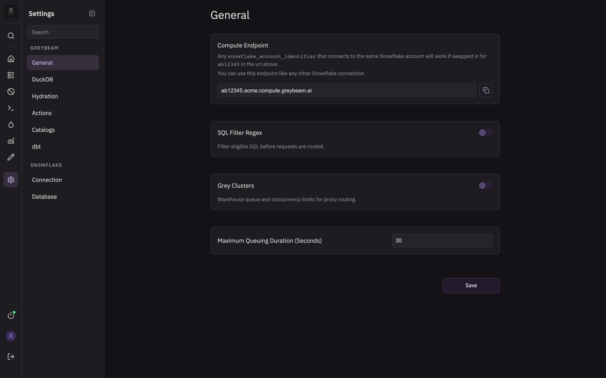

**Settings** holds your compute endpoint, the Snowflake connection Greybeam uses, and the schedules that keep your hydrated tables fresh. Open it from the sidebar.

<Frame>
  
</Frame>

## Who can edit what

- **Customer Viewer** — Doesn't see Settings.
- **Customer Developer** — Opens **General**, **DuckDB**, **Hydration**, and **Connection** as read-only. Runs the actions available under **Actions**.
- **Customer Admin** — Opens every tab and edits everything.

Read-only tabs show a note: "These settings are read-only." Passwords, private keys, and passphrases are write-only. The platform never shows them back, even to admins. See [Account settings](/platform/account-settings) for roles.

Click **Save** after you change anything on a tab.

## Tabs

The left navigation groups the tabs:

- **Greybeam** — **General**, **DuckDB**, **Hydration**, **Actions**, **Catalogs**, **dbt**
- **Snowflake** — **Connection**, **Database**

**Actions**, **Catalogs**, **dbt**, and **Database** are for Customer Admins. **Actions** is also available to Customer Developers.

## General

### Compute endpoint

**General** starts with **Compute Endpoint**. Click the copy button to copy it. Point your Snowflake clients at this host instead of Snowflake. They must use a [supported driver](/connect/drivers). Any account identifier for the same Snowflake account works in place of the one shown in the host.

For the full guide, including network allowlisting, see [Find your compute endpoint](/get-started/compute-endpoint).

<Tip>
**What you can do:** Customer Viewers can't open Settings. If you need the endpoint, ask a Developer or Admin to copy it.
</Tip>

### Other General settings

- **SQL Filter Regex** — A switch, plus **Multiline Regex** and the pattern. When on, queries whose SQL doesn't match the pattern aren't routed to DuckDB. They show routing code 303.
- **Maximum Queuing Duration (Seconds)** — A whole number from 1 to 600.
- **IP Whitelist** — Appears only when it's enabled for your account. Add IP addresses or CIDR ranges (such as `10.0.0.0/24`) with an optional comment, then click **Save Whitelist**.
- **Grey Clusters** — Expand to see **Warehouses**. Sets queue and concurrency limits for specific warehouses.

## DuckDB

The **DuckDB** tab has two size limits, in GiB. Tables larger than the limit aren't served from storage, and queries that touch them wait until the full download finishes.

- The limit for Snowflake tables and views.
- The limit for tables that use Iceberg CDC.

## Hydration

The **Hydration** tab sets the defaults for how Greybeam refreshes tables. Each table can override the refresh schedule and warehouse size in [Objects Explorer](/platform/objects-explorer).

<Warning>
Faster schedules and bigger warehouses use more Snowflake credits on the warehouse Greybeam uses. Raise them only for as long as you need them. Refreshing every minute costs noticeably more than every 15 minutes.
</Warning>

### Schedules

Schedules use the same picker everywhere. Choose **Cron**, **Interval**, **Never**, or **Default**. Some fields accept several cron schedules.

- **Default Tables Refresh** — How often Greybeam checks tables that have no schedule of their own. Each check that finds no change is recorded as **skipped** in [Hydration jobs](/platform/hydration-jobs).
- **Staleness Check Schedule** — A second pass that rechecks whether tables need to catch up, so a change the regular refresh missed doesn't leave a table stale. It also helps keep cached results from going out of date.
- **Load All Schedule** — How often Greybeam re-syncs object metadata from Snowflake, so new databases, tables, and dbt models show up.
- **DuckDB Cache Invalidation Schedule** — When Greybeam marks recent cached query results as stale, so they aren't reused after table schedules change.

### Freshness and timeouts

- **Data Freshness Threshold (SLO)** — The most minutes a table's last successful sync can age before the table counts as stale. Queries on a stale table go to Snowflake.
- **Hydration Job Timeout (seconds)** — Maximum time for a scheduled hydration job.
- **Hydration Query Timeout (seconds)** — Maximum time for one Snowflake query in a scheduled job. A table that exceeds it is turned off and must be turned on again.

Timeouts don't apply to refreshes you start from the platform.

### Warehouses

- **Warehouse Size (default)** and **Warehouse Size (hydration)** — Set warehouse sizes. Hover a size to see its credits per hour.
- **Warehouse Upgrade** — Raises the warehouse size during table and dataset updates.

### CDC settings

These name the Snowflake database, schema, warehouse, **External Volume**, and **S3 folder prefix** that tables using CDC rely on, plus **Warehouse size for CDC refreshes**.

### BI materialization

**Fast Hydration** refreshes Sigma materialized datasets after Greybeam sees an update, instead of waiting for the next batch. When on, you also set **Update threshold (minutes)**, **Warehouses**, **Fallback to hydration warehouse**, and a schedule. A refresh starts only after the update threshold has passed and only within that schedule.

## Actions

**Actions** runs maintenance tasks by hand, in groups: **Get Snowflake Objects Metadata**, **Download Active Snowflake Objects**, **DuckDB Engine Actions**, and **Delete Data**. Click **Run** next to an action. For example, **Load all objects** is the manual version of the **Load All Schedule**.

<Warning>
Actions in **Delete Data** are destructive. Ask in your shared Slack channel before you run one.
</Warning>

## Snowflake connection

**Snowflake** > **Connection** is the Snowflake account Greybeam uses to read your tables and run fallback queries.

- **Account** — Your Snowflake account identifier.
- **Warehouse** — The warehouse Greybeam uses.
- **Role** — The Snowflake role. This is the "Greybeam role" that needs access to your tables.
- **Username** — The Snowflake user.
- **Default Database** and **Default Schema** — Defaults for connections.
- **Authentication Method** — **Password** or **Private Key**. Private keys can be encrypted with a passphrase.

Admins can click **Test Snowflake Connection** to check the credentials before relying on them. **Save** is disabled until **Username** has a value.

<Warning>
Changing **Role** changes which tables Greybeam can see. Tables the new role can't read become untracked. See [Objects Explorer](/platform/objects-explorer#inactive-versus-untracked).
</Warning>

## Databases

**Snowflake** > **Database** lists the databases the Greybeam role can see. Switch a database on to have Greybeam keep its tables in sync and list them in [Objects Explorer](/platform/objects-explorer). Each database has these columns:

- **Load Tables** — Discover tables and views in the database.
- **Load Sigma Datasets** — Discover Sigma datasets.
- **Load Iceberg Tables** — Discover Iceberg tables.
- **Load Functions** — Load the functions that views use.
- **Load Schedule** — How often Greybeam re-scans this database. Same schedule types as the table schedule.

The header toggles switch a column on for every database. Click **Save** to apply. New databases need **Load databases** under **Actions** (or the next load) before they appear.

## Global platform switch

A separate switch at the bottom of the sidebar turns Greybeam routing on or off for the whole account. It's on by default. When it's off, every query goes to Snowflake, and clients see no errors or interruption. Customer Developers and Admins can use it.

## Related

<CardGroup cols={2}>
  <Card title="Find your compute endpoint" icon="link" href="/get-started/compute-endpoint">
    Copy the host and allowlist your network.
  </Card>
  <Card title="Hydration jobs" icon="arrows-rotate" href="/platform/hydration-jobs">
    Review refreshes and failures.
  </Card>
  <Card title="Objects Explorer" icon="table" href="/platform/objects-explorer">
    Per-table schedules and warehouse sizes.
  </Card>
  <Card title="Account settings" icon="users" href="/platform/account-settings">
    What each role can do.
  </Card>
</CardGroup>
