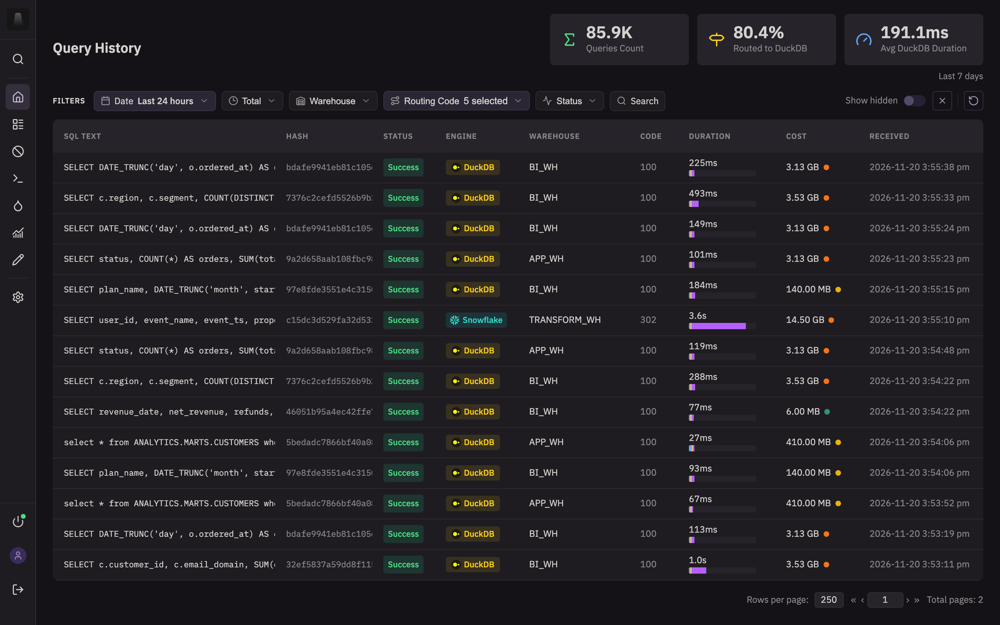

Connect one Snowflake client to Greybeam, run a query, and confirm in the platform that it ran on DuckDB. You only change the client's host.

## Before you begin

- You've finished [onboarding](/get-started/onboarding) and Greybeam has told you your account is ready.
- At least one table is **Active** in **Objects Explorer**. Greybeam only runs queries on DuckDB for active tables. To activate one, open it in **Objects Explorer** and turn on **Active**. See [Objects Explorer](/platform/objects-explorer).
- You know which table you'll query. Pick an active table that your Snowflake user can already read.

## Connect and run a query

<Steps>
  <Step title="Get your compute endpoint">
    In the Greybeam platform, go to **Settings** > **General** and copy the hostname in the **Compute Endpoint** card. It looks like `<account_locator>.<customer_name>.compute.greybeam.ai`. See [Find your compute endpoint](/get-started/compute-endpoint).
  </Step>

  <Step title="Change the host in one client">
    This example uses the Snowflake Connector for Python. Add `host` and set it to your compute endpoint. Keep every other parameter as it is today.

    ```python
    import os
    import snowflake.connector

    conn = snowflake.connector.connect(
        host="<your_compute_endpoint>",        # the only change
        account="<your_account_identifier>",   # unchanged
        user="<your_user>",                    # unchanged
        password=os.environ["SNOWFLAKE_PASSWORD"],  # or your existing auth method
        role="<your_role>",
        warehouse="<your_warehouse>",
        database="<your_database>",
        schema="<your_schema>",
    )
    ```

    For the other supported drivers, BI tools, and dbt, see [Drivers](/connect/drivers), [BI tools](/connect/bi-tools), and [dbt](/connect/dbt).
  </Step>

  <Step title="Run a query against an active table">
    Run a `SELECT` that reads only active tables:

    ```python
    cur = conn.cursor()
    cur.execute("SELECT * FROM <database>.<schema>.<active_table> LIMIT 10")
    print(cur.fetchall())
    ```

    You get rows back exactly as you would from Snowflake.

    If the connection fails, check your network allowlisting. See [Allow Greybeam through your network](/get-started/compute-endpoint#allow-greybeam-through-your-network).
  </Step>
</Steps>

## Confirm it ran on DuckDB

<Steps>
  <Step title="Find your query">
    In the Greybeam platform, click **Home**. Your query is at the top of the query history.
  </Step>
  <Step title="Check the routing code">
    Check the **CODE** column. Routing code `100` ("No issues") means the query ran on DuckDB. The **ENGINE** column shows which engine ran it.

    <Frame>
      
    </Frame>
  </Step>
  <Step title="Open the query details">
    Double-click the row to open the query details. You see the original Snowflake SQL, the DuckDB SQL Greybeam translated it to, and the tables it read. See [Query details](/platform/query-details).
  </Step>
</Steps>

For everything else on these screens, see [Query history](/platform/query-history).

## If it ran on Snowflake instead

Greybeam ran your query on Snowflake and returned Snowflake's result or error. Hover over the code in the **CODE** column to see why, or double-click the row for details. These are the most common codes for a first query. For every other code, see [Routing codes](/reference/routing-codes).

### 301: Table(s) in query not active

The table is **inactive**: Greybeam can see it, but it hasn't been turned on.

<Tip>**What you can do:** activate the table in **Objects Explorer**. Future queries against it can then run on DuckDB.</Tip>

### 300: Table(s) in query not tracked

The table is **untracked**: `GREYBEAM_ROLE` can't read it in Snowflake, so Greybeam doesn't know it exists.

<Tip>**What you can do:** grant `GREYBEAM_ROLE` read access to the table in Snowflake, then activate it in **Objects Explorer**.</Tip>

### 313: Table(s) data is stale or not route ready

Greybeam hasn't finished hydrating the table yet.

<Tip>**What you can do:** check its progress in **Hydration Jobs**, then run the query again.</Tip>

## Related

<CardGroup cols={2}>
  <Card title="Connect your BI tools" icon="chart-line" href="/connect/bi-tools">
    Point Looker and other BI tools at your compute endpoint.
  </Card>
  <Card title="Query routing" icon="route" href="/how-it-works/query-routing">
    Learn how Greybeam decides where each query runs.
  </Card>
  <Card title="Objects Explorer" icon="table" href="/platform/objects-explorer">
    Choose which tables Greybeam hydrates for DuckDB.
  </Card>
  <Card title="Query history" icon="clock-rotate-left" href="/platform/query-history">
    Filter queries by routing code and spot fallbacks.
  </Card>
</CardGroup>
