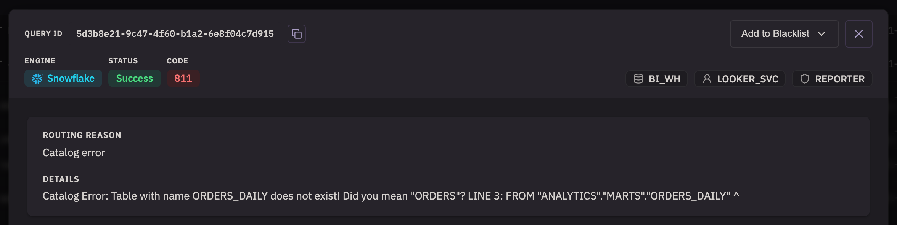

Look up any routing code from query history to see where the query ran, why, and whether you can do anything about it.

You'll find a query's code in the **CODE** column on **Home**, and under **Code** and **Routing Reason** in the [query details](/platform/query-details). For how Greybeam makes the decision, see [Query routing](/how-it-works/query-routing).

## How to read a code

The first digit tells you what happened:

- **1xx** — the query ran on DuckDB.
- **2xx** — the request is a kind DuckDB doesn't run, so it ran on Snowflake.
- **3xx** — DuckDB could run the query, but a table's state or a setting held it back.
- **700** — a specific engine was requested.
- **8xx** — DuckDB tried the query, failed, and the query fell back to Snowflake.
- **9xx** — routing to DuckDB is switched off.

Your client gets a normal Snowflake response whatever the code. To see which queries ran on Snowflake but could run on DuckDB, use the **Queries Routed to Snowflake** chart on [Analytics](/platform/analytics).

## 1xx: ran on DuckDB

The query passed every check and DuckDB answered it.

### 100: No issues

The query ran on DuckDB.

### 101: DuckDB query results lookup

Your client fetched the results of a query that ran on DuckDB.

### 102: DuckDB query monitoring lookup

Your client checked the status of a query running on DuckDB.

## 2xx: requests that run only on Snowflake

These requests are kinds DuckDB doesn't run, such as writes, metadata commands, or SQL Greybeam can't parse. Greybeam sends them to Snowflake by design.

### 200: No SQL

The request had no SQL text.

### 201: Metadata query

The request was a session or metadata command, such as `USE`, `SET`, `SHOW`, or `CURRENT_ROLE()`. Query history hides this code unless you select it in the **Routing Code** filter.

### 202: Transaction query

The request was a transaction command, such as `BEGIN`, `COMMIT`, or `ROLLBACK`. Query history hides this code by default.

### 203: DDL query

The statement creates or changes objects, such as `CREATE`, `DROP`, or `ALTER`. BI tools that build tables send these, for example Looker when it builds a PDT.

### 204: DML query

The statement writes data, such as `INSERT`, `UPDATE`, `DELETE`, or `MERGE`.

### 205: DCL query

The statement changes permissions, such as `GRANT` or `REVOKE`.

### 206: SQL parse error

Greybeam couldn't parse the query, or couldn't translate it to DuckDB SQL, because it uses syntax Greybeam doesn't support yet.

<Tip>**What you can do:** if you see many of these, share a **Query ID** with Greybeam on Slack.</Tip>

### 207: SQL text size is over 100KB

The SQL text is longer than 100 KB, which very large generated queries can hit.

### 208: Unknown query type

Greybeam couldn't tell what kind of statement this is.

<Tip>**What you can do:** if you see many of these, share a **Query ID** with Greybeam on Slack.</Tip>

### 209: Named bindings not supported

Query history can show this label, but Greybeam binds named variables when it runs a query on DuckDB, so named bind variables alone don't send a query to Snowflake.

<Tip>**What you can do:** if a recent query shows 209, share its **Query ID** with Greybeam on Slack.</Tip>

### 210: JsonV2n not supported

Your client asked for a result format Greybeam can't return from DuckDB.

<Tip>**What you can do:** share your client and driver version with Greybeam on Slack.</Tip>

### 211: Describe Query not supported

Your client asked Snowflake to describe a query's result columns without running it, which drivers do before some queries. Query history hides this code by default.

### 212: Explain Query not supported

The statement is an `EXPLAIN`.

### 213: Snowflake query failed

The query ran on Snowflake and failed there, so the error in the query details comes from Snowflake.

### 214: dbt query

The query came from a dbt run. See [dbt](/connect/dbt).

## 3xx: supported but held back

DuckDB could run these queries, but a table's state, a Greybeam rule, or one of your settings sent them to Snowflake. Greybeam stops at the first check that fails, so a query shows only the first reason. For the order of checks, see [Query routing](/how-it-works/query-routing#the-checks-in-order).

### 300: Table(s) in query not tracked

Greybeam's Snowflake role can't see at least one table in the query, so Greybeam can't tell whether the table exists. Untracked tables don't appear in [Objects Explorer](/platform/objects-explorer), and the query details list them without a link.

Common cause: the table is in a database or schema that was never granted to the Greybeam role, such as a newly added source.

<Tip>**What you can do:** in Snowflake, grant the Greybeam role access to the database, schema, or table. Once the table appears in Objects Explorer, turn it on. Whether that's worth it depends on how many queries touch the table. See [Inactive versus untracked](/platform/objects-explorer#inactive-versus-untracked).</Tip>

### 301: Table(s) in query not active

Greybeam can see the table in Snowflake, but it isn't turned on, so Greybeam hasn't hydrated it. One inactive table sends the whole query to Snowflake.

Common causes:
- A new table or dbt model that nobody has turned on yet.
- A very large table left off on purpose, to avoid the cost of keeping it in sync.
- Greybeam turned the table off because a scheduled refresh query ran past its timeout. See [Hydration](/how-it-works/hydration#when-a-refresh-fails).

<Tip>**What you can do:** in the [query details](/platform/query-details), **Details** lists the inactive tables with links. Click through and turn each table on in [Objects Explorer](/platform/objects-explorer). The **Inactive Tables** chart on **Analytics** > **Queries** shows which tables cause the most of these.</Tip>

### 302: Table(s) in query too large

Greybeam's size estimate for the query, based on the tables it references, is above the limit Greybeam sets for a DuckDB worker. The query details show the estimate and the limit under **Details**. The estimate is related to the **Cost** column in query history, which adds up table sizes.

### 303: SQL doesn't match regex filter

**SQL Filter Regex** is on in **Settings** > **General**, and this query doesn't match it.

<Tip>**What you can do:** change the filter or turn it off. See [Settings](/platform/settings).</Tip>

### 304: DuckDB Sigma dataset is outdated

Sigma rebuilt a materialized dataset, and Greybeam hasn't loaded the new version yet. This clears after the next refresh.

<Tip>**What you can do:** turn on **Fast Hydration** to refresh Sigma materialized datasets after the update threshold passes, when your schedule allows. See [Settings](/platform/settings).</Tip>

### 305: Query is blacklisted (SQL text)

The query's SQL text matches an entry in the [Query Blacklist](/platform/query-blacklist), so Greybeam sent it straight to Snowflake without trying DuckDB.

Common causes:
- The query kept timing out on DuckDB (code [813](#813-late-retrieval)), so Greybeam added it.
- Someone on your team added it with **Add to Blacklist** in the query details.

<Tip>**What you can do:** in the query details, **Routing Reason** links to the matching entry. Remove the entry if you want Greybeam to try DuckDB again.</Tip>

### 306: Query is blacklisted (tables included)

The set of tables the query reads matches a [Query Blacklist](/platform/query-blacklist) entry. Entries get there the same ways as for [305](#305-query-is-blacklisted-sql-text).

<Tip>**What you can do:** follow the **Routing Reason** link in the query details to the entry, and remove it if you want Greybeam to try DuckDB again.</Tip>

### 307: Query is blacklisted (tables joined)

The tables the query joins match a [Query Blacklist](/platform/query-blacklist) entry. Entries get there the same ways as for [305](#305-query-is-blacklisted-sql-text).

<Tip>**What you can do:** follow the **Routing Reason** link in the query details to the entry, and remove it if you want Greybeam to try DuckDB again.</Tip>

### 308: DuckDB Sigma SIGDS dataset is outdated

A Sigma dataset changed, and Greybeam hasn't loaded the new version yet. This clears after the next refresh.

### 310: DuckDB Looker PDT dataset is outdated

Looker rebuilt a persistent derived table (PDT) under a new name, and Greybeam hasn't loaded it yet. Greybeam picks it up on the next refresh.

### 311: Table existence check

A BI tool checked whether a table exists with a query that returns no rows. The full label in the platform is `Table existence check (WHERE 1 <> 1 LIMIT 0)`. Greybeam hides these from query history.

### 312: CONVERT_TIMEZONE not supported in DuckDB

The query uses `CONVERT_TIMEZONE`, which Greybeam sends to Snowflake. See [SQL support](/reference/sql-support).

### 313: Table(s) data is stale or not route ready

The table is turned on, but its data on DuckDB might not match Snowflake right now, so Greybeam ran the query on Snowflake to give you the current answer.

Common causes:
- The table was just turned on and its first load hasn't finished.
- The last successful check is older than the **Data Freshness Threshold (SLO)** in **Settings** > **Hydration**. This happens when the table's schedule is slower than the threshold, or set to **Never**.
- The last refresh failed. The table stays unavailable until a refresh succeeds.

<Tip>
**What you can do:** in the [query details](/platform/query-details), **Details** lists the affected tables. Open each one in [Objects Explorer](/platform/objects-explorer):
1. Click the table name and check **Loadable** and **Fresh Until**.
2. Open the **Hydration Jobs** tab. A **Failed** or **Timed Out** job explains the problem.
3. On the **Hydration** tab, click **Update** to refresh now. This tab appears only for a Customer Admin. If you don't see it, ask a Customer Admin to do this step.

If 313 happens often, make the table's schedule shorter than the freshness threshold. See [Hydration](/how-it-works/hydration#freshness-and-staleness).
</Tip>

### 314: timeLimit not supported in DuckDB

The query uses `GENERATOR` with `TIMELIMIT`, which Looker sends to test query cancellation.

### 318: Sigma transient dataset is outdated

Sigma created a temporary dataset after Greybeam's last refresh.

## 700: forced routing

A specific engine was requested for the query, so Greybeam skipped most of its usual checks. The [kill switch](#9xx-kill-switch) and the SQL size limit are checked first and override a forced engine. Greybeam also rejects a Query Runner request to run a write statement, and a request to force DuckDB for tables too large for DuckDB.

### 700: System forced routing

The query asked for a specific engine, for example from the [Query Runner](/platform/query-runner), and Greybeam used it.

## 8xx: DuckDB failed, then fell back to Snowflake

Greybeam sent the query to DuckDB, DuckDB couldn't finish it, and Greybeam ran it on your Snowflake account instead. Greybeam returns Snowflake's result or error to your client, and it takes longer, because Snowflake started only after DuckDB failed. Except for timeouts, Greybeam tries DuckDB again the next time the same query runs.

To see DuckDB's error, open the query in [query details](/platform/query-details). The **Details** field under **Routing Reason** shows the message.

### 800: DuckDB query failed

DuckDB returned an error that has no more specific code, such as an invalid input, an out-of-range value, or an internal failure.

<Tip>**What you can do:** if the same query keeps failing, share its **Query ID** with Greybeam on Slack.</Tip>

### 801: DuckDB cluster ran out of connections

DuckDB had no free capacity when the query arrived.

Common causes:
- Every DuckDB worker was busy with other queries.
- DuckDB workers were busy with a large data load, such as loading a big table.

<Tip>**What you can do:** an occasional 801 needs no action. If you see many, tell Greybeam on Slack.</Tip>

### 802: Query timed out while waiting in queue

The query waited in the DuckDB queue longer than **Maximum Queuing Duration (Seconds)** in **Settings** > **General**. Bursts of queries arriving together cause this. On **Home**, queued time shows as orange in the duration bars.

<Tip>**What you can do:** raise **Maximum Queuing Duration (Seconds)** so queries wait longer for DuckDB before falling back. See [Settings](/platform/settings). If you run many queries at once, ask Greybeam on Slack for more DuckDB workers.</Tip>

### 803: Query reallocation limit exceeded

The query was handed to a new DuckDB worker too many times, for example while workers restarted. Greybeam manages this.

### 804: No available DuckDB worker

No DuckDB worker was running to take the query, for example during a restart.

<Tip>**What you can do:** if it keeps happening, tell Greybeam on Slack.</Tip>

### 810: Binder error

DuckDB read the query but couldn't match one of its names or types. For example, it called a function with argument types DuckDB doesn't accept, or used a column DuckDB couldn't resolve. The message in **Details** reads like `No function matches the given name and argument types` or `Referenced column ... not found`.

<Tip>**What you can do:** there's usually nothing to change on your side. If you see a sudden spike, message Greybeam on Slack with a **Query ID**. Greybeam can add support for the function or suggest a workaround.</Tip>

### 811: Catalog error

DuckDB couldn't find a table, view, schema, or function the query refers to.

To see what's missing, open the query in [query details](/platform/query-details). The **Details** field under **Routing Reason** shows DuckDB's error, for example which table doesn't exist.

<Frame></Frame>

Common causes:
- The table's data on DuckDB is out of date or still downloading. For example, the table was just created, renamed, or replaced in Snowflake, and Greybeam hasn't loaded the new version yet.
- The query calls a function DuckDB doesn't have, and Greybeam doesn't translate it yet. The message reads like `Scalar Function with name ... does not exist`.

<Tip>**What you can do:** if **Details** names a table, open it in [Objects Explorer](/platform/objects-explorer). On its **Hydration** tab, click **Update** to replicate the latest data, or **Redownload** to reload the whole table. These actions need the Customer Admin role; other roles can ask a Customer Admin to run them. If a refresh is already running, wait for it to finish; its progress shows on the **Hydration Jobs** tab. If **Details** names a function, share the **Query ID** with Greybeam on Slack.</Tip>

### 812: Conversion error

DuckDB couldn't convert a value from one type to another, for example a text value that isn't a valid number or date. Snowflake and DuckDB sometimes accept different values for the same conversion.

<Tip>**What you can do:** rewrite the query, or add an explicit cast, so the types line up. If the same query keeps failing, share its **Query ID** with Greybeam on Slack.</Tip>

### 813: Late retrieval

The query ran longer than Greybeam allows on DuckDB, so Greybeam stopped it and ran it on Snowflake. When the same query keeps timing out, Greybeam adds it to the [Query Blacklist](/platform/query-blacklist), and later runs go straight to Snowflake with code [305](#305-query-is-blacklisted-sql-text), [306](#306-query-is-blacklisted-tables-included), or [307](#307-query-is-blacklisted-tables-joined).

### 814: Parser error

Greybeam translated the query to DuckDB SQL, and DuckDB rejected the result. That's a translation gap on Greybeam's side, not a problem with your query.

<Tip>**What you can do:** changing the query, in your client or in the model that generates it, can make it run on DuckDB. Share the **Query ID** with Greybeam on Slack so the gap gets fixed.</Tip>

### 815: Out of memory

The query needed more memory than a DuckDB worker had, for example for a large join or aggregation.

<Tip>**What you can do:** ask Greybeam on Slack to increase DuckDB worker memory. Or make the query lighter: filter earlier, select fewer columns, or pre-aggregate.</Tip>

## 9xx: kill switch

Routing to DuckDB is switched off, so every query runs on Snowflake. Your clients aren't interrupted.

### 900: User kill switch active

Someone on your team turned off the **Platform** switch at the bottom of the sidebar.

<Tip>**What you can do:** turn **Platform** back on when you're ready. See [The platform switch](/platform/overview#the-platform-switch).</Tip>

### 901: System kill switch active

Greybeam turned off DuckDB routing for your account.

<Tip>**What you can do:** ask Greybeam on Slack.</Tip>

## Get help

Copy the **Query ID** from the top of the query details and share it with Greybeam in your Slack channel. With it, the team can find the query, its routing decision, and any DuckDB error.

## Related

<CardGroup cols={2}>
  <Card title="Query routing" icon="route" href="/how-it-works/query-routing">
    How Greybeam decides where each query runs.
  </Card>
  <Card title="Query details" icon="magnifying-glass" href="/platform/query-details">
    Read a query's routing reason and DuckDB error.
  </Card>
  <Card title="Hydration" icon="droplet" href="/how-it-works/hydration">
    How tables stay fresh, and why stale tables run on Snowflake.
  </Card>
  <Card title="Query Blacklist" icon="ban" href="/platform/query-blacklist">
    Review and remove blacklisted queries.
  </Card>
</CardGroup>
